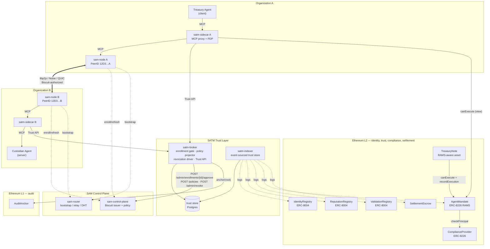
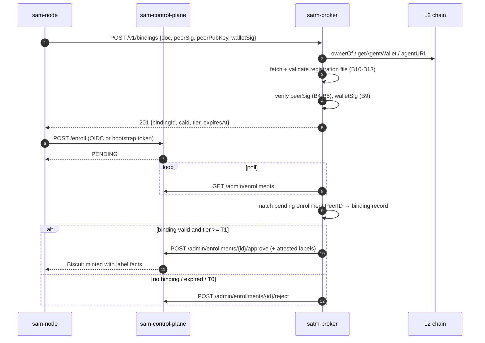
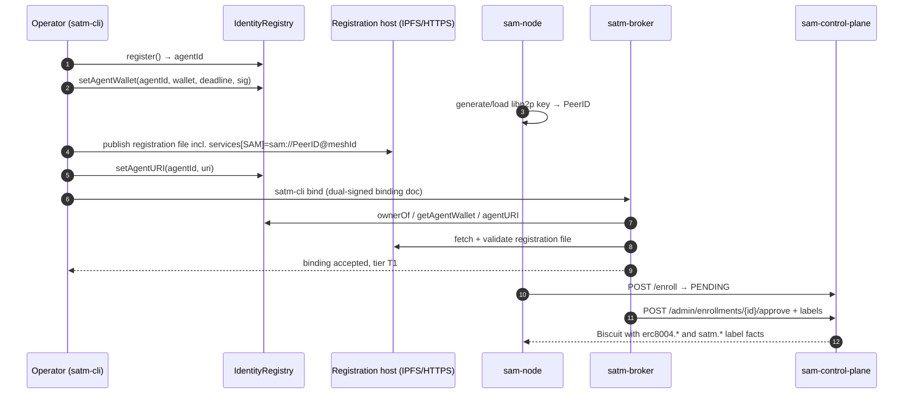
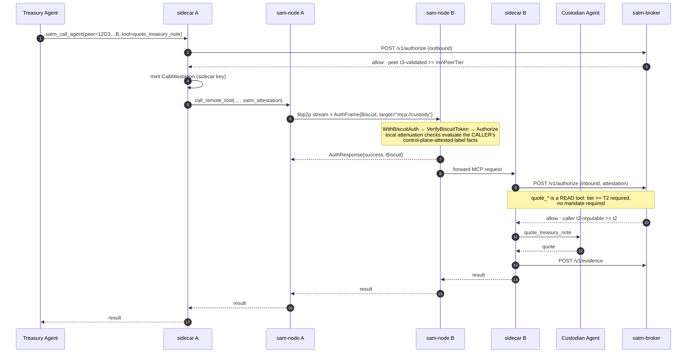
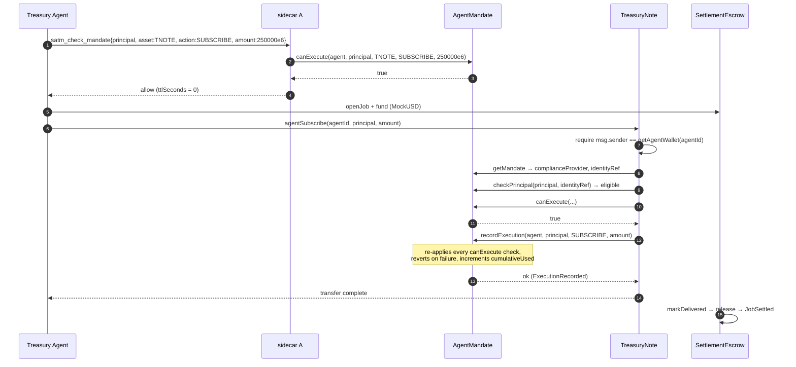

# Sovereign Agent Trust Mesh — Technical Specification

**Prototype codename:** SATM
**Version:** 0.1 (Draft for Implementation)
**Status:** Specification — approved for prototyping
**Derived from:** [CONCEPT-BRIEF.md](CONCEPT-BRIEF.md)
**Companion documents:** [PLAN.md](PLAN.md) · [docs/RESEARCH-NOTES.md](docs/RESEARCH-NOTES.md) · [docs/adr/](docs/adr)

---

## 0. Document Control

| Field | Value |
| --- | --- |
| Author | Yorke Rhodes |
| Audience | Product architects, distributed systems engineers, AI platform teams, blockchain engineers, enterprise identity teams, compliance stakeholders |
| Normative sources | Google SAM (`github.com/google/sam`, Apache-2.0), [ERC-8004](https://ercs.ethereum.org/ERCS/erc-8004), [ERC-8226](https://eips.ethereum.org/EIPS/eip-8226) |
| Requirement keywords | MUST / SHOULD / MAY per RFC 2119 and RFC 8174 |

Every upstream fact this specification depends on is cited in
[docs/RESEARCH-NOTES.md](docs/RESEARCH-NOTES.md). Where an upstream behaviour could not be
verified, this specification is written so the prototype does **not** depend on it.

---

## 1. Purpose, Scope and Non-Goals

### 1.1 Purpose

The concept brief identifies six capabilities that no single existing architecture provides:
global agent discovery, portable agent identity, portable reputation, cross-organizational
trust, compliance-aware delegation of authority, and verifiable economic settlement.

SAM provides secure agent networking but has no notion of global reputation, economic trust,
verifiable compliance mandates, or cross-network trust portability. ERC-8004 provides a portable
identity and trust substrate but no transport. ERC-8226 provides machine-verifiable delegated
authority but no identity or transport.

**The prototype's job is to build the missing joint: a bidirectional, cryptographically sound
binding between a SAM mesh identity and an on-chain agent identity, and the enforcement
machinery that makes on-chain trust and authority actually gate mesh traffic and asset
movement.**

That joint is the SATM **Trust Broker** and its companion **Trust Sidecar**. Everything else in
the prototype exists to exercise and prove that joint.

### 1.2 In scope

1. **Agent Mesh Binding (AMB)** — a dual-signature protocol binding a libp2p PeerID to an
   ERC-8004 `agentId` (§4).
2. **Trust Broker** — gates SAM control-plane enrollment on on-chain verification, projects
   on-chain trust into SAM policy, and drives revocation (§6.1).
3. **Trust Sidecar** — per-agent MCP proxy providing initiator-side trust evaluation, mandate
   pre-checks, and evidence capture (§6.3).
4. **Chain Indexer** — event-sourced projection of registry state into a queryable trust store (§6.2).
5. **Contracts** — vendored ERC-8004 registries; a from-spec ERC-8226 (RAMS) implementation; a
   RAMS-aware regulated demo asset; a settlement escrow; an L1 audit anchor (§7).
6. **Demo agents** — Treasury Agent (client), Custodian Agent (server), Validator Agent (§6.5).
7. **End-to-end treasury scenario** matching the concept brief's workflow (§9.6).

### 1.3 Out of scope for the prototype

| Excluded | Rationale |
| --- | --- |
| Production KYC/AML integration | `ComplianceProvider` is a role-gated stub with a documented adapter seam. |
| Real regulated securities or real value | Testnet-only; demo asset is a mock. |
| zkML validation | `ValidationPort` abstraction only; a replay validator is implemented instead. |
| TEE attestation | Interface reserved; ERC-8004's validation section is explicitly in flux. |
| Forking SAM | SATM MUST integrate through documented seams only (see [ADR-0001](docs/adr/0001-integrate-via-control-plane-not-fork.md)). |
| Mainnet deployment | Testnets and a local devnet only. |
| Cross-chain agent identity | Single identity chain per mesh in v0.1. |
| Production HA / multi-tenant broker | Single-instance broker with a Postgres backing store. |

### 1.4 Success criteria (from the brief)

| Brief criterion | Demonstrated by | Verified in |
| --- | --- | --- |
| Dynamic agent discovery | Registry-first discovery resolving to live mesh peers | §9.2 |
| Secure agent communication | SAM libp2p + Noise + Biscuit authorization | §9.4 |
| Portable agent identity | ERC-8004 `agentId` bound to PeerID via AMB | §4 |
| Reputation-based agent selection | Counterparty ranking from `ReputationRegistry` | §9.3 |
| Verifiable delegation | RAMS mandate checked off-chain and enforced on-chain | §9.5 |
| Automated settlement | `SettlementEscrow` release on delivery | §11 |
| Full auditability | Evidence log + Merkle root anchored to L1 | §12 |

---

## 2. Terminology

| Term | Definition |
| --- | --- |
| **Agent** | An autonomous software process that can be discovered, addressed, and held accountable. |
| **`agentId`** | ERC-8004 Identity Registry ERC-721 `tokenId`. |
| **`agentRegistry`** | CAIP-style `{namespace}:{chainId}:{identityRegistry}`, e.g. `eip155:84532:0x8004a818…`. |
| **CAID** | *Canonical Agent Identifier*: `{agentRegistry}/{agentId}`. The primary key throughout SATM. |
| **`agentWallet`** | ERC-8004 reserved metadata key; the address at which an agent receives payment. In SATM it is also the agent's RAMS `agent` address ([ADR-0003](docs/adr/0003-agentwallet-is-the-rams-agent-address.md)). |
| **PeerID** | libp2p identity of a `sam-node` (`12D3KooW…`). |
| **AMB** | Agent Mesh Binding — the dual-signature attestation binding a CAID to a PeerID (§4). |
| **Principal** | The verified legal identity delegating authority under ERC-8226. |
| **Mandate** | An ERC-8226 grant of scoped, time-bounded, capped authority from a principal to an agent for one asset. |
| **Trust Tier** | SATM's ordinal summary of an agent's counterparty trustworthiness, `T0`–`T3` (§5.2). Authority is a **separate** axis. |
| **PDP / PEP** | Policy Decision Point / Policy Enforcement Point. |
| **Broker** | `satm-broker`, the Trust Broker service. |
| **Sidecar** | `satm-sidecar`, the per-agent Trust Sidecar. |

---

## 3. Architecture

### 3.1 Plane model

The concept brief's six planes map onto concrete components as follows.

| # | Plane | Brief's technology | SATM realisation |
| --- | --- | --- | --- |
| 1 | Communication | SAM, A2A, MCP | `sam-control-plane`, `sam-router`, `sam-node`; MCP as the agent API surface |
| 2 | Identity | ERC-8004 Identity Registry | `IdentityRegistry` + **AMB binding protocol** + broker-attested SAM labels |
| 3 | Trust | ERC-8004 Reputation + Validation | `ReputationRegistry`, `ValidationRegistry`, `satm-indexer`, tiering engine |
| 4 | Compliance | ERC-8226 | `AgentMandate` (RAMS), `ComplianceProvider`, sidecar pre-check + on-chain enforcement |
| 5 | Settlement | Ethereum L2, stablecoins | `SettlementEscrow` + `MockUSD` on the L2 devnet/testnet |
| 6 | Audit | Ethereum L1 | Evidence log → Merkle root → `AuditAnchor` on L1 |

### 3.2 Component diagram



### 3.3 Design principles

1. **No fork of SAM.** All integration uses documented HTTP endpoints and the `sam-node.yaml`
   attenuation block. See [ADR-0001](docs/adr/0001-integrate-via-control-plane-not-fork.md).
2. **The chain is the source of truth; the mesh caches.** SAM labels and policy are a
   *projection* of on-chain state with bounded staleness, never an independent authority.
3. **Two-sided enforcement.** The broker gates *admission*; the sidecar gates *use*. Neither
   alone is sufficient, because SAM Biscuits have a TTL and on-chain state can change inside it.
4. **On-chain enforcement is authoritative for value.** Off-chain mandate checks are an
   optimisation to fail fast and save gas; the RAMS-aware asset re-checks atomically at transfer.
5. **Fail closed, with bounded and audited exceptions.** Asset-moving authorization fails closed
   unconditionally. Other authorizations fail closed except within the explicitly bounded
   staleness windows enumerated in §14.2, each of which is logged as `stale=true`.
6. **Everything decision-relevant is evidence.** Every allow/deny carries a reason code and is
   written to the evidence log, which is what makes the audit plane meaningful.

---

## 4. Agent Mesh Binding (AMB)

This is the core novel mechanism. Everything else composes existing standards.

### 4.1 The problem

ERC-8004 gives an agent a portable identity (`agentId`, owned by an ERC-721 holder, with a
verified `agentWallet`). SAM gives an agent a transport identity (a libp2p PeerID, attested by
the control plane via a Biscuit). **Nothing connects them.** Without a binding:

- A holder of `agentId 42` cannot prove that peer `12D3KooW…A` is that agent → reputation is
  not portable to the mesh.
- A peer on the mesh cannot prove it is `agentId 42` → an impostor can free-ride on reputation.
- A mandate granted to an on-chain address cannot be enforced against a mesh peer.

A one-way claim is insufficient. If only the registration file names a PeerID, anyone who reads
the chain can claim to be that PeerID's owner is unverifiable in the other direction; if only
the node signs, it can claim any `agentId`.

### 4.2 Requirements

| ID | Requirement |
| --- | --- |
| AMB-1 | The binding MUST prove control of the libp2p private key for the claimed PeerID. |
| AMB-2 | The binding MUST prove control of the on-chain `agentWallet` for the claimed `agentId`. |
| AMB-3 | The on-chain registration file MUST independently advertise the claimed PeerID, so the binding is discoverable chain-first. |
| AMB-4 | The binding MUST be replay-protected and bound to a specific mesh and control plane. |
| AMB-5 | The binding MUST expire and be re-provable. |
| AMB-6 | The binding MUST be invalidated when the agent's ERC-721 token is transferred. |

AMB-6 is satisfied for free by ERC-8004: `agentWallet` is **automatically cleared on transfer**
and must be re-verified by the new owner. The broker treats an `agentWallet` of `address(0)` as
"no valid binding".

### 4.3 The binding document

Canonical JSON (RFC 8785 JCS), UTF-8, no trailing whitespace:

```json
{
  "type": "urn:satm:binding-v1",
  "agentRegistry": "eip155:84532:0x8004a818bfb912233c491871b3d84c89a494bd9e",
  "agentId": "42",
  "agentWallet": "0x1111111111111111111111111111111111111111",
  "peerId": "12D3KooWA1b2c3d4e5f6g7h8i9j0k1l2m3n4o5p6q7r8s9t0u1v2",
  "sidecarKey": "ed25519:z6Mkf5rGMoatrSj1f4CyvuHBeXJELe9RPdzo2PKGNCKVtZxP",
  "meshId": "satm-dev",
  "controlPlane": "https://cp.satm.local",
  "nonce": "72038947156932847561093847561029384756102938475610293847561029384756",
  "issuedAt": "2026-08-22T13:00:00Z",
  "expiresAt": "2026-08-29T13:00:00Z"
}
```

#### Field encoding rules (normative)

These are spelled out because the document is hashed and cross-signed by two different
signature systems, and an under-specified encoding is a substitution vulnerability, not a
cosmetic issue.

| Field | Encoding |
| --- | --- |
| `agentRegistry` | CAIP-style `{namespace}:{chainId}:{address}`. Address MUST be **lowercase hex with `0x` prefix** (not EIP-55 checksummed), so canonicalisation is unambiguous. |
| `agentId` | Decimal **string** — avoids JSON number precision loss for large token IDs. |
| `agentWallet` | Lowercase `0x` hex, 20 bytes. |
| `peerId` | libp2p PeerID in its canonical base58btc text form. |
| `sidecarKey` | `ed25519:` + multibase base58btc of the raw 32-byte Ed25519 public key. Used for call attestations (§6.3.3). |
| `nonce` | **Decimal string** of a 256-bit CSPRNG value. Represented as `uint256` in EIP-712 without conversion ambiguity. |
| `issuedAt`, `expiresAt` | RFC 3339 UTC, second precision, `Z` suffix. |

### 4.4 The two signatures

**Signature 1 — PeerID proof.** The node signs `SHA-256(canonical_json)` with its libp2p host
private key, producing `peerSignature` plus the protobuf-marshalled public key.

The broker MUST derive the PeerID using **libp2p's canonical derivation** — the semantics of
`peer.IDFromPublicKey`, i.e. multihash over the protobuf-serialised public key, using the
`identity` multihash function when the serialised key is ≤ 42 bytes and `sha2-256` otherwise.
An ad-hoc "hash the raw key bytes" check is **not** equivalent and would accept keys that do not
actually produce the claimed PeerID. For the prototype, host keys MUST be **Ed25519**, so
derivation is deterministic and the identity-multihash path always applies. This proves AMB-1.

**Signature 2 — Wallet proof.** The `agentWallet` key signs an EIP-712 typed message:

```solidity
// EIP-712 domain
name              = "SATM"
version           = "1"
chainId           = <chainId of the ALLOW-LISTED registry tuple>       // not from the document
verifyingContract = <IdentityRegistry address of that tuple>           // not from the document

bytes32 constant MESH_BINDING_TYPEHASH = keccak256(
  "MeshBinding(uint256 agentId,string peerId,string sidecarKey,string meshId,"
  "string controlPlane,bytes32 documentHash,uint256 nonce,uint256 deadline)");
```

Typed-data value mapping (normative):

| Typed-data field | Source |
| --- | --- |
| `agentId` | `uint256(doc.agentId)` parsed from the decimal string |
| `peerId`, `sidecarKey`, `meshId`, `controlPlane` | the document strings verbatim |
| `documentHash` | `keccak256(canonical_json)` — transitively commits to every field |
| `nonce` | `uint256(doc.nonce)` parsed from the decimal string |
| `deadline` | `doc.expiresAt` as unix seconds — MUST equal it exactly |

**The EIP-712 domain is derived from the broker's allow-listed registry tuple, never from the
document.** Otherwise an attacker could name a registry they control, and the signature would be
verified against a domain of their choosing (see check B2a).

The broker verifies with `SignatureChecker.isValidSignatureNow(agentWallet, digest, sig)`
semantics so smart-contract wallets (ERC-1271) and EIP-7702 accounts work. This proves AMB-2.

> Reusing the ERC-8004 `setAgentWallet` proof pattern is deliberate: an agent operator already
> possesses the key management needed to satisfy it.

### 4.5 The chain-side advertisement

The agent's registration file MUST contain a `SAM` service entry. ERC-8004 explicitly permits
arbitrary additional service entries.

```json
{
  "type": "https://eips.ethereum.org/EIPS/eip-8004#registration-v1",
  "name": "Acme Custodian Agent",
  "description": "Tokenized treasury custody and subscription services.",
  "image": "https://acme.example/agent.png",
  "services": [
    { "name": "SAM",
      "endpoint": "sam://12D3KooWA1b2c3…@satm-dev",
      "version": "v1alpha1" },
    { "name": "MCP",
      "endpoint": "sam://12D3KooWA1b2c3…@satm-dev/mcp/custody",
      "version": "2025-06-18" },
    { "name": "A2A",
      "endpoint": "https://acme.example/.well-known/agent-card.json",
      "version": "0.3.0" }
  ],
  "x402Support": false,
  "active": true,
  "registrations": [
    { "agentId": 42,
      "agentRegistry": "eip155:84532:0x8004a818bfb912233c491871b3d84c89a494bd9e" }
  ],
  "supportedTrust": ["reputation", "crypto-economic"]
}
```

**`sam://` URI grammar** (SATM-defined, registered in the registration file only):

```
sam-uri     = "sam://" peer-id "@" mesh-id [ "/" service-type "/" service-name ]
peer-id     = base58btc multihash        ; e.g. 12D3KooW…
mesh-id     = 1*63( ALPHA / DIGIT / "-" / "_" / "." )
service-type= "mcp" / "inference" / "a2a"
service-name= 1*63( ALPHA / DIGIT / "-" / "_" / "." )
```

`service-type`/`service-name` deliberately mirror SAM's own `type://name` service format so a
resolved URI maps directly onto `call_remote_tool` arguments.

### 4.6 Verification algorithm

The broker MUST perform all of these, in order, and MUST deny on the first failure:

```
verify_binding(doc, peerSig, peerPubKey, walletSig):
  B1  issuedAt < expiresAt
      AND now <  doc.expiresAt
      AND now >= doc.issuedAt - CLOCK_SKEW
      AND doc.expiresAt <= doc.issuedAt + binding.maxTTL      # bounds self-issued lifetime
  B2  doc.meshId == broker.meshId AND doc.controlPlane == broker.controlPlane
  B2a R := canonical(doc.agentRegistry)                        # lowercase, normalised
      R ∈ broker.trustedRegistries                             # EXACT allow-list match
      ⇒ bind chainId, identityRegistry := R
        ALL subsequent chain calls, the EIP-712 domain, the CAID, and every attested
        label are derived from R — NEVER from any other document field
  B3  doc.nonce is well-formed uint256 and not present in the consumed-nonce table
      (checked here; CONSUMED atomically at B15)
  B4  peerIdFromPublicKey(peerPubKey) == doc.peerId            # libp2p canonical derivation
  B5  verify(peerPubKey, sha256(canonical(doc)), peerSig)
  B6  onchain[R]: ownerOf(doc.agentId) does not revert         # agent exists
  B7  onchain[R]: w := getAgentWallet(doc.agentId); w != address(0)
  B8  w == doc.agentWallet
  B9  verify_eip712(w, MESH_BINDING digest, walletSig)         # domain from R; ERC-1271 aware
  B9a w is not already bound to a DIFFERENT active CAID        # one wallet ⇒ one agent (§7.2a)
  B10 uri := agentURI(doc.agentId); f := fetch(uri)            # size/scheme limited
  B11 f.registrations contains { agentRegistry: R, agentId: doc.agentId }
  B12 f.services contains an entry name=="SAM" whose endpoint parses to
      peer-id == doc.peerId AND mesh-id == doc.meshId
  B13 f.active == true
  B14 optional: if an HTTPS service endpoint is advertised, fetch
      https://{domain}/.well-known/agent-registration.json and confirm a matching
      registrations entry  → sets domainVerified flag (does not gate admission)
  B15 COMMIT atomically, in one transaction:
        - INSERT nonce  (UNIQUE constraint; violation ⇒ 409 nonce.reused)
        - revoke any existing active binding for this CAID     # rotation
        - INSERT the new binding record
```

#### Why the ordering matters

- **B2a before B6.** Every chain read and the EIP-712 domain must be derived from an
  allow-listed registry. If the document's own `agentRegistry` were trusted, an attacker could
  deploy an ERC-8004-shaped contract, mint themselves `agentId 42` with any `agentWallet`, and
  satisfy B6–B9 against their own registry. The resulting CAID and labels would then name a
  registry nobody trusts, while looking structurally valid.
- **B3 checks, B15 consumes.** Consuming the nonce before signature verification would let an
  unauthenticated caller burn arbitrary nonces (a denial-of-service). Merely *checking* without
  an atomic insert would allow two concurrent requests to both pass B3 and both commit. The
  check-then-atomic-insert-under-unique-constraint split closes both.
- **B1's upper bound.** Without `expiresAt <= issuedAt + maxTTL`, a signer could self-issue a
  decade-long binding, defeating AMB-5 and outliving `binding.nonceRetention` — after which the
  nonce record is purged and the document becomes replayable.

`B4` MUST use libp2p's canonical `peer.IDFromPublicKey` semantics (§4.4), not an ad-hoc hash.

`B10` MUST enforce: allow-listed URI schemes (`https`, `ipfs`, `data`), a response size cap
(default 256 KiB), a fetch timeout (default 5 s), and no redirects to private address ranges
(SSRF defence). See §13.

#### One active binding per agent (v0.1)

B15 revokes any prior active binding for the CAID, so **an agent has exactly one live PeerID at a
time**. This makes key rotation (A3) unambiguous — re-binding atomically retires the old peer —
at the cost of ruling out multi-node HA for a single agent identity. Recorded as OI-9.

### 4.7 Outcome

On success the broker records a **Binding Record** in the trust store and attests SAM labels
(§6.1.3). The binding record is the join key between the mesh world and the chain world:

```
PeerID  ⟷  BindingRecord  ⟷  CAID (agentRegistry/agentId)  ⟷  agentWallet  ⟷  RAMS mandates
```

---

## 5. Trust Model

### 5.1 What each source can and cannot prove

| Question | Answered by | Confidence |
| --- | --- | --- |
| Is this peer cryptographically who it says? | libp2p Noise + Biscuit peer binding | Strong |
| Is this peer a registered agent? | AMB + IdentityRegistry | Strong |
| Who owns/stands behind it? | `ownerOf(agentId)`, registration file, optional domain verification | Medium |
| Has it performed well historically? | ReputationRegistry | Weak (Sybil-exposed) |
| Was specific work verified independently? | ValidationRegistry | Medium–Strong |
| Is it authorized to move this asset now? | RAMS `canExecute` | Strong |
| Was value actually exchanged? | `SettlementEscrow` events | Strong |

ERC-8004's own security considerations state that Sybil attacks on reputation are possible and
that `getSummary` MUST be filtered by `clientAddresses`. SATM therefore treats reputation as a
**ranking** signal, never an **admission** signal.

### 5.2 Two orthogonal axes: trust tier and authority

An early draft of this specification modelled authority as the top rung of a single ladder
(`T4 = t4-mandated`, requiring T3). **That was wrong.** It conflates two independent questions:

- *"How much do I trust this agent as a counterparty?"* — earned from third parties over time.
- *"Does this agent hold delegated authority to move this asset right now?"* — granted by a
  principal, instantaneous, and revocable in one block.

Requiring T3 for a mandate would mean a corporate treasury agent acting purely on its **own**
principal's behalf could not be authorized until strangers had reviewed it. That is backwards:
the mandate's trust comes from the KYC-verified principal behind it, not from the agent's
service reputation.

SATM therefore models the two separately.

#### Axis 1 — Trust tier (counterparty trustworthiness)

Ordinal and monotonic: each tier's predicate includes all lower tiers.

| Tier | Label value | Predicate | Grants |
| --- | --- | --- | --- |
| **T0** | `t0-unverified` | No valid binding | No mesh admission |
| **T1** | `t1-registered` | Valid AMB binding; `active == true` | Mesh admission; discovery; may call `public` services |
| **T2** | `t2-reputable` | T1 **and** reputation score ≥ threshold from ≥ *N* distinct allow-listed clients | May call `commercial` services; may be selected as counterparty |
| **T3** | `t3-validated` | T2 **and** ≥ *M* passing validations (`response ≥ 80`) from allow-listed validators within window *W* | May call `regulated` services |

Defaults for the prototype: `N = 3`, threshold = `starred ≥ 70/100`, `M = 1`, `W = 30 days`.
All are configuration, not code.

#### Axis 2 — Authority (delegated mandate)

| Label value | Predicate | Grants |
| --- | --- | --- |
| `none` | No mandate satisfying the below | May not initiate asset-moving actions |
| `active` | ≥ 1 RAMS mandate that is unrevoked, inside its validity window, and not frozen | May *attempt* asset-moving actions, subject to a live `canExecute` **and** a live principal-eligibility re-check at execution time |

The label reflects mandate **existence and validity**, not principal eligibility. ERC-8226
consults `IComplianceProvider` only at `grantMandate`, so a principal whose KYC expires or is
revoked afterwards still has a formally valid mandate. SATM closes that gap in the asset's
compliance hook (§7.3, step 2a), which is the only layer that can enforce it atomically — not in
this label, which is stale the moment it is minted.

The `satm.mandate` label is a **coarse hint only**. It says "this agent held at least one live
mandate when its Biscuit was minted". It never authorizes a specific action: scope, asset,
action label, and both caps are checked per call against `canExecute`, and authoritatively
on-chain by `recordExecution` (§5.4, §9.5).

#### How the axes combine

The two axes are consumed **asymmetrically**, and that asymmetry is the point:

- **Outbound — choosing a counterparty.** The caller demands a minimum *tier* of the callee.
  Reputation and independent validation are exactly what make a provider worth trusting with your
  business. Authority is irrelevant here: you do not care whether your custodian holds a mandate.
- **Inbound — accepting a caller.** The callee demands *identity* and, for anything that moves an
  asset, *authority*. A custodian does not care whether its client has third-party reviews; it
  cares that the client is identified, is not a stranger off the street, and is actually
  authorized to place the order.

| Direction | Applies to | Minimum tier of the other party | Requires `satm.mandate=active` |
| --- | --- | --- | --- |
| Outbound | any counterparty Atlas selects | T3 *(per-caller config)* | n/a |
| Inbound | `mcp://public-*` | T1 | no |
| Inbound | `mcp://commercial-*` | T2 | no |
| Inbound | `mcp://custody` read tools (`quote_*`) | T2 | no |
| Inbound | `mcp://custody` asset tools (`subscribe_*`, `redeem_*`) | T2 | **yes**, plus a live `canExecute` |

Because SAM label matching is exact and case-sensitive, "tier ≥ T2" is projected as a
disjunction — `label(tier,"t2-reputable") or label(tier,"t3-validated")` — which is precisely the
shape `api.LabelCheck` already builds (§10.2).

So in the demo the Custodian is **T3 with no mandate**, and the Treasury Agent is **T2 with an
active mandate**. Both are correct. The Custodian earned a high tier by serving clients well; the
Treasury Agent holds authority because a KYC-verified CFO granted it. Neither property implies
the other, and neither agent is disadvantaged by lacking the other's.

### 5.3 Reputation scoring

Because `getSummary` requires a non-empty `clientAddresses` filter, SATM maintains a **reviewer
allow-list** per mesh.

**"Any bound agent" is not a Sybil defence.** An earlier draft populated the allow-list with every
agent holding a valid AMB binding at ≥ T1. That is close to worthless: ERC-8004 registration is
permissionless and cheap, so an attacker registers three agents, binds them, has them review each
other, and clears `minDistinctClients = 3`. Requiring "an identified agent" only raises the cost
by the price of a few `register()` calls.

A reviewer allow-list is only meaningful if entries are **scarce, accountable, or costly**. v0.1
therefore uses an **operator-curated** list, with three documented production paths:

| Mechanism | How it resists Sybils | Status |
| --- | --- | --- |
| Operator-curated roster | Manual admission; the mesh operator vouches | **v0.1 default** |
| Settlement-weighted reviewers | `w(client)` scales with verified `JobSettled` volume with *other* counterparties — reviews cost real economic activity | designed, Phase 5 stretch |
| Proof-of-personhood / KYC'd reviewers | Externally unique identities | out of scope; adapter seam noted |
| Staked reviewers with slashing | Bad reviews are economically punished | future ([PLAN.md §13](PLAN.md)) |

`minDistinctClients` remains necessary but is explicitly **not sufficient** on its own, and the
prototype's negative control is written to prove the strong case (an attacker who *does* control
three registered agents) rather than the trivial one.

Score for tag `starred`:

```
score(agent) = Σ_i w(client_i) · decay(age_i) · normalize(value_i, valueDecimals_i)
               ────────────────────────────────────────────────────────────────────
                                 Σ_i w(client_i) · decay(age_i)

normalize(v, d) = v / 10^d                       # per ERC-8004 fixed-point semantics
decay(age)      = 0.5 ^ (age / halfLife)         # halfLife default 90 days
w(client)       = 1.0 if on the curated reviewer allow-list, else 0   (v0.1)
```

Revoked feedback (`isRevoked`) MUST be excluded. Self-feedback is already prevented on-chain.

### 5.4 Freshness and staleness

| Datum | Max staleness | On exceed |
| --- | --- | --- |
| Binding record | `expiresAt` (default 7 d) | Deny; require re-binding |
| Reputation score | 15 min fresh; `staleServeWindow` 1 h | Serve with `stale=true`, deny tier promotion; past the window, treat the agent as T1 |
| Validation status | as above | as above |
| Mandate status | **0 — never cached for enforcement** | Sidecar MUST read `canExecute` at decision time |
| Indexer head lag | 32 blocks (configurable) | Broker enters degraded mode (§14.2) |

Mandate state is never cached because a mandate can be revoked or an agent frozen at any block,
and the consequence is unauthorized asset movement.

---

## 6. Component Specifications

### 6.1 `satm-broker` — Trust Broker

Language: **Go** (shares SAM's ecosystem and can import `github.com/google/sam/api` for the
Datalog/label vocabulary, which is a public package). Single binary, horizontally scalable
behind a leader lock for the anchoring job.

#### 6.1.1 Responsibilities

| # | Responsibility | Mechanism |
| --- | --- | --- |
| R1 | Verify AMB bindings | §4.6 |
| R2 | Gate mesh admission | `POST /admin/enrollments/{id}/approve` \| `/reject` |
| R3 | Project on-chain trust into SAM policy | `POST /policies` |
| R4 | Drive revocation on trust loss | `POST /admin/revoke` |
| R5 | Serve trust decisions to sidecars | Trust API (§6.1.4) |
| R6 | Maintain the evidence log and anchor it | §12 |

#### 6.1.2 Enrollment gate

The SAM control plane MUST be started with `--auto-approve-enrollment=false`. Every enrollment
then sits `ENROLLMENT_STATUS_PENDING` until an admin acts on
`POST /admin/enrollments/{id}/{action}`.



**Ordering requirement:** the binding MUST be registered before enrollment is approved. If a
pending enrollment has no matching binding after `bindingGracePeriod` (default 10 min), the
broker MUST reject it. This is fail-closed by construction.

> **Implementation risk (Q2 in research notes):** whether labels can be supplied in the approve
> call is not yet verified. §6.1.3 defines a fallback that does not require it.

#### 6.1.3 Label projection

The broker attests these labels. All conform to SAM's key syntax (`[a-zA-Z0-9_.-]{1,63}`) and
value constraints (≤255 chars, no `,` `=` or control characters) — verified in `api/labels.go`.

| Label key | Example value | Meaning |
| --- | --- | --- |
| `erc8004.registry` | `eip155:84532:0x8004a818bfb912233c491871b3d84c89a494bd9e` | Which registry |
| `erc8004.agent_id` | `42` | Which agent |
| `erc8004.owner` | `0xabc…` | ERC-721 owner at attestation time |
| `erc8004.wallet` | `0x111…` | Verified `agentWallet` |
| `satm.trust_tier` | `t2-reputable` | Tier at attestation time |
| `satm.mandate` | `active` \| `none` | Whether ≥1 qualifying mandate existed at mint time (coarse hint only — §5.2) |
| `satm.binding_exp` | `1756472400` | Binding expiry, unix seconds |
| `satm.domain_verified` | `true` \| `false` | ERC-8004 optional endpoint-domain check |

> **All hex in label values MUST be lowercase**, matching the canonical encoding in §4.3. SAM
> label matching is **exact and case-sensitive** (`api/labels.go`), so an EIP-55 checksummed
> address in a projected label would silently fail to match the same address written in lowercase
> in a node's `attenuation` check — an authorization outage with no error message. The broker
> normalises on write and the generated Datalog is produced from the same normalised value, so the
> two cannot drift.

**Mechanism (verified empirically — spike S-1, see [docs/SPIKE-FINDINGS.md](docs/SPIKE-FINDINGS.md)):**
labels are **declared by the node** and **attested by the admin at approval**.

An earlier draft of this section offered a "primary" path in which the broker supplied
labels *in* the approve call, with declare-then-validate as a fallback. **The primary
path does not exist.** `POST /admin/enrollments/{id}/approve` takes an empty body; the
control plane mints whatever labels were recorded on the pending request. SAM's own
protobuf says so:

```proto
// Operator-declared labels; the admin approving the enrollment attests
// them (see EnrollRequest.labels).
map<string, string> labels = 5;
```

So the flow is:

1. The node declares labels at startup: `sam-node run --labels "k=v,k2=v2"`.
   (Note: the flag is on `run`, **not** on `join`.)
2. They appear on the pending enrollment, readable by the broker via
   `GET /admin/enrollments`.
3. The broker compares each declared label against the verified binding and
   **approves only on an exact match**, rejecting otherwise.
4. Approval mints them into the control-plane-signed Biscuit.

**The trust property is unchanged by this correction**, which is why it is a correction
and not a redesign: a node may declare `erc8004.agent_id=999`, but it gets no Biscuit
unless the broker agrees. Approval is the gate; declaration is only an input to it.
**A node can never self-assert an unverified label**, because the control plane mints
label facts solely for approved enrollments.

Verified Biscuit contents after approval:

```
facts: [ expiration(2026-08-24T18:13:51Z)
         node("12D3KooWALK8sCkh…")  client_peer_id("12D3KooWALK8sCkh…")
         label("erc8004.agent_id", "42")
         label("erc8004.registry", "eip155:84532:0x8004a818bfb912233c491871b3d84c89a494bd9e")
         label("satm.trust_tier", "t3-validated")
         role("sam:role:node")  granted_service_all_types()  target_unrestricted() ]
```

CAID values survive flag parsing, protobuf, storage and minting unchanged — colons and
all — which was an open risk given SAM's label-value constraints.

#### 6.1.4 Trust API

`POST /v1/bindings` — submit an AMB binding (§4.3). → `201` with binding record, or `4xx` with a
reason code.

`GET /v1/agents/{caid}` — resolved agent view:

```json
{
  "caid": "eip155:84532:0x8004a818…/42",
  "agentId": "42",
  "owner": "0xAbC…",
  "agentWallet": "0x111…",
  "active": true,
  "registrationFile": { "…": "…" },
  "binding": { "peerId": "12D3KooW…", "meshId": "satm-dev",
               "expiresAt": "2026-08-29T13:00:00Z", "domainVerified": true },
  "reputation": { "score": 87.4, "sampleSize": 12, "tag": "starred",
                  "clients": 5, "stale": false, "asOfBlock": 9123456 },
  "validation": { "passing": 3, "failing": 0, "lastResponse": 100,
                  "lastValidator": "0xVaL…", "asOfBlock": 9123456 },
  "trustTier": "t3-validated",
  "asOf": "2026-08-22T13:04:00Z"
}
```

`GET /v1/agents?skill=…&minTier=…&limit=…` — **registry-first discovery** (§9.2).

`POST /v1/authorize` — the PDP entry point used by sidecars.

**Sidecar authentication is mandatory.** Every sidecar receives a broker-issued credential when
its agent's binding is committed (B15). The broker derives `self` **from the authenticated
channel**, never from the request body; a `self` field in the body is ignored if present. Without
this, any process able to reach the broker could impersonate an arbitrary CAID and obtain a
favourable decision.

Inbound and outbound take **different peer inputs** (§6.3.4). Outbound, shown here, identifies the
peer by PeerID and lets the *broker* resolve it through its own binding table — the caller cannot
forge a CAID it does not own, because it never supplies one:

```json
{
  "direction": "outbound",
  "peer":  { "peerId": "12D3KooW…B" },
  "service": "mcp://custody",
  "tool": "subscribe_treasury_note",
  "argsHash": "0x…",
  "mandate": {
    "principal": "0xPr1nc1pal…",
    "asset":     "0xTN0TE…",
    "action":    "SUBSCRIBE",
    "amount":    "250000000000"
  }
}
```

The inbound form replaces `peer.peerId` with `peer.attestation`, a base64url Call Attestation
verified per §6.3.3.

Response:

```json
{
  "decision": "allow",
  "reasons": [
    "peer.binding.valid",
    "peer.tier.t3-validated>=t3-validated",
    "self.mandate.active",
    "self.mandate.canExecute=true"
  ],
  "peer": { "caid": "eip155:84532:0x8004a818…/42", "trustTier": "t3-validated" },
  "self": { "caid": "eip155:84532:0x8004a818…/7",  "trustTier": "t2-reputable", "mandate": "active" },
  "mandateCheck": { "canExecute": true, "checkedAtBlock": 9123460 },
  "evidenceId": "ev_01J…",
  "ttlSeconds": 0
}
```

Reason codes are prefixed `peer.` or `self.` because an outbound decision applies the two axes to
**different parties**: the peer must meet the caller's minimum *tier*, while the caller must hold
the *authority* (§5.2). Flattening them into one list without prefixes was ambiguous.

`ttlSeconds` is `0` whenever a `mandate` block was present — mandate decisions MUST NOT be
cached (§5.4).

`POST /v1/evidence` — append a signed evidence record (§12.2).
`GET /v1/evidence/{id}/proof` — Merkle inclusion proof against an anchored root.
`GET /healthz` · `GET /readyz` · `GET /metrics` (Prometheus).

#### 6.1.5 Continuous reconciliation

A reconciliation loop runs every `reconcileInterval` (default 60 s) and, for every active binding:

1. Re-reads `getAgentWallet(agentId)`. If it is now `address(0)` (token transferred) or differs
   from the binding → **revoke immediately** via `POST /admin/revoke`.
2. **Re-runs B10–B13 in full** against the current `agentURI`. Revoke if any of the following no
   longer holds: `active == true`; a `registrations` entry matching the allow-listed registry
   tuple and `agentId`; a `services` entry named `SAM` advertising **exactly this** PeerID and
   mesh.
3. Recomputes the trust tier. On **downgrade**, re-projects policy and, if the new tier is T0,
   revokes.
4. If the binding expires within `renewWindow` (default 24 h), emits a `binding.expiring` event.

Step 2 must re-run the *whole* registration check, not just `active`. Verification (B12) requires
the file to advertise the PeerID, so the advertisement is part of what makes the binding valid;
if an operator removes or repoints the `SAM` service entry — the natural way to decommission a
node — a reconciliation that only re-read `active` would leave the retired PeerID authorised
until its binding expired. Revoking the advertisement is therefore a supported revocation path,
and the demo exercises it.

This closes the gap between a 24-hour Biscuit TTL and on-chain state that can change in one block.

### 6.2 `satm-indexer`

Language: **Go**. May be replaced by a subgraph later; the port is what matters.

- Subscribes to logs from `IdentityRegistry`, `ReputationRegistry`, `ValidationRegistry`,
  `AgentMandate`, `ComplianceProvider`, `SettlementEscrow`.
- Events consumed: `Registered`, `URIUpdated`, `MetadataSet`, `Transfer`, `NewFeedback`,
  `FeedbackRevoked`, `ResponseAppended`, `ValidationRequest`, `ValidationResponse`,
  `MandateGranted`, `ActionEnabled`, `MandateRevoked`, `MandateExtended`, `ExecutionRecorded`,
  `AgentFrozen`, `AgentUnfrozen`, `PrincipalGranted`, `PrincipalRevoked`, plus escrow events.
- **Reorg-safe:** stores `blockNumber` + `blockHash` per event; on reorg, rolls back to the last
  common ancestor and replays. Only events with ≥ `confirmations` (default 5 on L2) promote
  state used for tier decisions.
- **Idempotent:** primary key `(txHash, logIndex)`.
- Maintains a `head_lag` gauge driving the broker's degraded mode.
- Fetches and caches registration files with the same SSRF-hardened fetcher as §4.6/B10.

Trust-store schema (abridged):

```sql
CREATE TABLE agents (
  caid TEXT PRIMARY KEY, chain_id BIGINT, registry TEXT, agent_id NUMERIC,
  owner TEXT, agent_wallet TEXT, agent_uri TEXT,
  registration_json JSONB, active BOOLEAN,
  last_block BIGINT, updated_at TIMESTAMPTZ);

CREATE TABLE bindings (
  id TEXT PRIMARY KEY, caid TEXT REFERENCES agents(caid),
  peer_id TEXT NOT NULL, mesh_id TEXT NOT NULL,
  sidecar_key TEXT NOT NULL,
  document JSONB, peer_sig BYTEA, wallet_sig BYTEA,
  domain_verified BOOLEAN, issued_at TIMESTAMPTZ, expires_at TIMESTAMPTZ,
  revoked_at TIMESTAMPTZ, revoke_reason TEXT);
-- A PeerID may back at most one live agent…
CREATE UNIQUE INDEX ON bindings(peer_id, mesh_id) WHERE revoked_at IS NULL;
-- …and an agent has at most one live PeerID (§4.6, one-active-binding rule).
CREATE UNIQUE INDEX ON bindings(caid, mesh_id)   WHERE revoked_at IS NULL;

CREATE TABLE consumed_nonces (
  nonce NUMERIC PRIMARY KEY,          -- uint256; UNIQUE gives B15 its atomicity
  consumed_at TIMESTAMPTZ NOT NULL,
  expires_at TIMESTAMPTZ NOT NULL);   -- retained >= binding.maxTTL

CREATE TABLE feedback (
  caid TEXT, client TEXT, feedback_index BIGINT,
  value NUMERIC, value_decimals SMALLINT, tag1 TEXT, tag2 TEXT,
  is_revoked BOOLEAN, block BIGINT, tx_hash TEXT, log_index INT,
  PRIMARY KEY (tx_hash, log_index));

CREATE TABLE validations (
  request_hash TEXT PRIMARY KEY, caid TEXT, validator TEXT,
  response SMALLINT, tag TEXT, response_uri TEXT, last_update BIGINT);

CREATE TABLE mandates (
  agent TEXT, principal TEXT, asset TEXT,
  valid_from BIGINT, valid_until BIGINT, revoked BOOLEAN,
  max_tx NUMERIC, max_cum NUMERIC, cumulative_used NUMERIC,
  compliance_provider TEXT, identity_ref TEXT, metadata TEXT,
  PRIMARY KEY (agent, principal));      -- matches ERC-8226 storage keying

CREATE TABLE mandate_actions (
  agent TEXT, principal TEXT, action TEXT, enabled BOOLEAN,
  PRIMARY KEY (agent, principal, action));

CREATE TABLE evidence (
  id TEXT PRIMARY KEY, seq BIGSERIAL, caid TEXT, kind TEXT,
  payload JSONB, payload_hash BYTEA, prev_hash BYTEA, created_at TIMESTAMPTZ);

CREATE TABLE anchors (
  root BYTEA PRIMARY KEY, from_seq BIGINT, to_seq BIGINT,
  l1_tx_hash TEXT, l1_block BIGINT, uri TEXT, anchored_at TIMESTAMPTZ);
```

> The `mandates` primary key intentionally mirrors ERC-8226's `(agent, principal)` storage
> keying, with `asset` as a column — because the standard permits **at most one active mandate
> per pair**, and each mandate covers exactly one asset. Modelling it any other way would
> silently diverge from the standard.

### 6.3 `satm-sidecar` — Trust Sidecar

Language: **Go**. Runs next to each agent as a transparent MCP proxy.

```
Agent  ──MCP──▶  satm-sidecar  ──MCP──▶  sam-node  ──libp2p──▶  remote sam-node
```

The sidecar exists because the broker cannot see individual tool calls, and because SAM's
node-level Datalog can express "is this caller bound and tiered?" but not "is this specific
transfer within this mandate's remaining cumulative cap right now?".

#### 6.3.1 Inbound (server side)

The sidecar re-checks the caller before the agent sees the request:

- verify the **Call Attestation** (§6.3.3) → authenticated caller CAID and PeerID
- resolve that CAID → binding → tier, **fresh from the broker**, not from the Biscuit
- enforce the per-service minimum tier and, for asset tools, `satm.mandate=active` plus a live
  `canExecute`
- deny if the binding was revoked since the Biscuit was minted (the TTL gap)
- write an evidence record

#### 6.3.2 Outbound (client side)

The sidecar performs the initiator-side check itself:

1. resolve the target PeerID → CAID → trust tier
2. enforce the caller's configured `minPeerTier`
3. if the call carries a mandate context, call `canExecuteStrict` **at the current block**
4. mint a Call Attestation (§6.3.3) and attach it to the outbound MCP request
5. allow / deny, emit evidence

**SAM provides a genuine second layer here (verified in spike S-3).** An earlier draft treated
initiator-side evaluation as UNVERIFIED and deliberately did not rely on it. It exists:
`call_remote_tool` accepts a `required_labels` argument, and `VerifyPeerLabels`
(`internal/node/labels_gate.go`) verifies the responder's returned Biscuit against trusted
control-plane keys and fails closed. Observed:

```
required_labels erc8004.agent_id=99   (true of the peer)  -> "Echo: satm-s3"
required_labels erc8004.agent_id=12345 (false)            -> DENIED
  provider 12D3KooWETadEYZD… has no attested label matching
  map[erc8004.agent_id:12345]
```

The sidecar therefore SHOULD pass the peer's required tier as `required_labels`, so SAM enforces
it at the transport layer in addition to the sidecar's own check. Two caveats:

- It is **opt-in per call**. Omitting `required_labels` means no check at all, so this is not a
  safety net that applies by default.
- It matches only coarse attested labels. It cannot express "this asset, this action, within
  this remaining cap", which is why mandate decisions remain a live `canExecuteStrict` plus
  authoritative on-chain enforcement (§9.5).

#### 6.3.3 Call Attestation — authenticated caller identity

**The problem.** The inbound sidecar sits behind `sam-node` and receives a forwarded MCP request.
SAM authenticates the peer at the transport layer (`WithBiscuitAuth`), but **it does not pass the
authenticated caller identity to a locally-spawned service.** This was confirmed in spike S-5:
`internal/node/gate.go` describes the path as a *"dumb-pipe proxy"* and calls
`mcpSvc.HandleStreamPassThrough(s)`, forwarding the raw stream. `reqCtx` carries the caller's
`PeerID` but is used only to select the target service and is then discarded. Empirically, the
spawned subprocess sees no `SAM_*`, `PEER_*` or `CALLER_*` environment variables.

So if the sidecar simply trusted a `peerId` field in the request, any caller could name someone
else's CAID and inherit their tier and authority. **The Call Attestation is therefore necessary,
not defence-in-depth** — it is the only mechanism by which the inbound sidecar learns who called.
The S-2 fallback in [PLAN.md](PLAN.md), which moves inbound enforcement entirely into the
sidecar, is sound *because* this exists.


**The mechanism.** Each agent's sidecar holds an Ed25519 **sidecar key** whose public half is
inside the binding document (`sidecarKey`, §4.3) and is therefore covered by *both* binding
signatures. The broker publishes CAID → `sidecarKey` through the Trust API.

The initiator's sidecar signs, per call:

```json
{
  "type": "urn:satm:call-attestation-v1",
  "meshId": "satm-dev",
  "controlPlane": "https://cp.satm.local",
  "callerCaid": "eip155:84532:0x8004a818…/7",
  "callerPeerId": "12D3KooW…A",
  "callerBindingId": "bnd_01J…",
  "targetCaid": "eip155:84532:0x8004a818…/42",
  "targetPeerId": "12D3KooW…B",
  "targetBindingId": "bnd_01K…",
  "service": "mcp://custody",
  "tool": "quote_treasury_note",
  "argsHash": "0x…",
  "nonce": "0x…",
  "issuedAt": "2026-08-22T13:40:00Z",
  "expiresAt": "2026-08-22T13:40:30Z"
}
```

Encoding is normative: RFC 8785 canonical JSON, Ed25519 over `SHA-256(canonical_json)`, signature
and `nonce` carried as base64url; the whole envelope is transported as a base64url MCP argument
named `satm_attestation`.

The responder's sidecar MUST verify **all** of the following and deny on the first failure:

| # | Check | Prevents |
| --- | --- | --- |
| V1 | `meshId` and `controlPlane` equal this mesh's | Cross-mesh replay |
| V2 | `targetCaid`, `targetPeerId`, `targetBindingId` equal **this agent's own current** values | Replay of a captured attestation at a different callee, or after the callee re-bound |
| V3 | `service` and `tool` equal the **actual** request being served | Escalating a `quote_*` attestation into a `subscribe_*` call |
| V4 | `argsHash` equals the canonical hash of the **received** arguments | Body substitution |
| V5 | Signature verifies against `sidecarKey` of `callerBindingId`, fetched from the broker | Forgery |
| V6 | `callerBindingId` is the caller CAID's **current active** binding, and `callerPeerId` matches that binding's PeerID | Use of a revoked or superseded binding, or a stale key epoch |
| V7 | `issuedAt`/`expiresAt` within `attestation.ttl` (30 s) allowing `clockSkew` | Long-lived replay |
| V8 | `(callerBindingId, nonce)` consumed **atomically before forwarding**, under a unique constraint | Concurrent replay; crash-safety |

**V3 is not optional.** An attestation that signs `service` and `tool` but is only checked against
target and args would let a caller obtain a cheap attestation for a read tool and present it to an
asset-moving tool.

**V6 is what makes `sidecarKey` revocable.** Because `callerBindingId` is inside the signature and
must be the *current* binding, re-binding an agent (which B15 does atomically) invalidates every
outstanding attestation signed under the old sidecar key. The binding id therefore doubles as a
key epoch.

**Channel binding.** SAM does **not** expose an authenticated caller PeerID to a locally-spawned
service — confirmed in spike S-5 (§6.3.3 rationale above). `attestation.requireChannelBinding`
therefore stays `false` for this version of SAM: there is no second channel to bind to. The
setting is retained because the check is cheap and strictly strengthening if upstream ever adds
caller metadata to the forwarded stream.

This deliberately does not reuse the `agentWallet` key: that key is cold, on-chain-facing, and
must not be in the hot path of every tool call. The sidecar key is a hot, rotatable credential
whose authority derives from having been co-signed into the binding.

#### 6.3.4 Authorize call shapes

Inbound and outbound authorization answer different questions and therefore take different
inputs. An earlier draft used one schema requiring an attestation in both directions, which
contradicted the outbound flow — the initiator must be *authorized* before it mints an
attestation, so the attestation cannot be an input to its own authorization.

| | Outbound (`direction: "outbound"`) | Inbound (`direction: "inbound"`) |
| --- | --- | --- |
| Question | "May I call this peer?" | "May this caller call me?" |
| `self` | From the authenticated sidecar channel | From the authenticated sidecar channel |
| Peer identity | `peer.peerId` — resolved by the **broker** through its own binding table; the caller cannot forge it because the broker does the lookup | `peer.attestation` — verified per §6.3.3 |
| Mandate block | Present when the call will move an asset | Present when the served tool moves an asset |

Order of operations on the initiator side is therefore: **authorize → mint attestation → send**.

#### 6.3.5 SATM MCP tools

The sidecar additionally exposes tools so an LLM-driven agent can reason about trust natively:

| Tool | Purpose |
| --- | --- |
| `satm_discover_agents` | Registry-first discovery: `{skill, minTier, limit}` → ranked agents with CAID, PeerID, tier, score |
| `satm_get_agent_trust` | Full trust view for one CAID |
| `satm_check_mandate` | `{principal, asset, action, amount}` → `canExecute` + decoded reason |
| `satm_call_agent` | Trust-checked wrapper over SAM's `call_remote_tool` |
| `satm_submit_feedback` | Post ERC-8004 feedback after a completed job |
| `satm_request_validation` | Open an ERC-8004 validation request |
| `satm_get_evidence` | Retrieve evidence + Merkle proof for a job |

`satm_check_mandate` MUST decode a `false` into a specific reason by re-evaluating the mandate
fields client-side (expired / revoked / frozen / wrong asset / action not enabled / per-tx cap /
cumulative cap). ERC-8226's `canExecute` returns a bare boolean, which is useless for operator
diagnostics on its own.

### 6.4 Contracts

See §7.

### 6.5 Demo agents

| Agent | Role | Key behaviours |
| --- | --- | --- |
| **Treasury Agent** (Org A) | Client / principal-delegated | Discovers custodians, ranks by reputation, checks its own mandate, subscribes to treasury notes, posts feedback |
| **Custodian Agent** (Org B) | Server | Exposes `mcp://custody` with `quote_treasury_note`, `subscribe_treasury_note`, `redeem_treasury_note`; enforces inbound tier ≥ T2 on all tools, and additionally requires `satm.mandate=active` plus a live `canExecute` on the asset-moving tools |
| **Validator Agent** (Org C) | Validator | Watches `ValidationRequest`, re-executes the quote deterministically, responds `100`/`0` |
| **Rogue Agent** (negative control) | Attacker | Unbound; or bound at T1 reaching for a T2 service; or T2 but unmandated; or mandated but over cap — used to prove denials |

The Rogue Agent is a first-class deliverable: a trust prototype that only demonstrates the happy
path proves nothing.

### 6.6 `satm-cli` and console

`satm-cli` covers operator flows: `bind`, `register-agent`, `publish-registration`,
`grant-mandate`, `revoke-mandate`, `freeze-agent`, `feedback`, `validate`, `anchor`,
`trust show`, `policy dump`.

The console is an optional read-only web view (agent directory, trust tiers, mandate status,
evidence timeline, anchor history). It is a Phase 6 stretch item.

---

## 7. On-Chain Specification

### 7.1 Contract inventory

| Contract | Source | Chain | Notes |
| --- | --- | --- | --- |
| `IdentityRegistry` | Vendored from `erc-8004/erc-8004-contracts` (CC0) | L2 | Use canonical testnet deployment `0x8004A818BFB912233c491871b3d84c89A494BD9e` where available; deploy locally on devnet |
| `ReputationRegistry` | Vendored | L2 | Canonical testnet `0x8004B663056A597Dffe9eCcC1965A193B7388713` |
| `ValidationRegistry` | Vendored | L2 | **No canonical address published; SATM deploys its own.** Spec section is in flux — isolate behind `ValidationPort` |
| `AgentMandate` | **New — implements `IAgentMandate`** | L2 | From the ERC-8226 text |
| `ComplianceProvider` | **New — implements `IComplianceProvider`** | L2 | Role-gated stub with adapter seam |
| `TreasuryNote` | **New** | L2 | ERC-20, 6 decimals, RAMS-aware transfer hook |
| `EquityNote` | **New** | L2 | Second asset with **no** mandate — proves the "✗ Purchase Equities" denial |
| `SettlementEscrow` | **New** | L2 | Job-scoped escrow in `MockUSD` |
| `MockUSD` | **New** | L2 | 6-decimal test stablecoin |
| `ReplayValidator` | **New** | L2 | Validator contract used by the Validator Agent |
| `AuditAnchor` | **New** | L1 | Merkle root anchoring |

Toolchain: **Foundry** for SATM-authored contracts (fast fuzz/invariant testing), consuming the
vendored registries' ABIs. See [ADR-0004](docs/adr/0004-foundry-with-vendored-registries.md).

### 7.2 `AgentMandate` — ERC-8226 implementation

Implements `IAgentMandate` verbatim. The following MUST hold and each maps to a conformance test
(§16.2):

1. `mandates[agent][principal]`; `grantMandate` reverts if an active mandate exists for the pair.
2. `grantMandate` reverts if `complianceProvider == address(0)`.
3. `grantMandate` reverts if `complianceProvider.checkPrincipal(principal, identityRef)` returns
   `eligible == false`.
4. At grant, previously enabled actions for the pair are cleared, then `actions[]` is written to
   `actionEnabled[agent][principal][action]`; `revoked = false`; `cumulativeUsed = 0`. One
   `ActionEnabled` event per action.
5. `extendMandate` reverts if `newValidUntil <= validUntil`; `cumulativeUsed` is **not** reset.
6. `canExecute` implements the normative pseudocode exactly (§ research notes 3.6).
7. `recordExecution` is callable **only** by `m.asset`, `principal`, or a `RECORDER_ROLE` holder;
   it re-applies every `canExecute` check and reverts on failure; it reverts if
   `amount > maxTransactionValue` or `cumulativeUsed + amount > maxCumulativeValue`
   (except where the cap is `type(uint256).max`).
8. `freezeAgent`/`unfreezeAgent` are restricted to `ENFORCER_ROLE`; the enforcer address is
   recorded in the event. **`DEFAULT_ADMIN_ROLE` MUST NOT be granted to any `ENFORCER_ROLE`
   holder** — enforced by a deployment-time assertion *and* an invariant test.
9. EIP-712 domain `("RAMS", "1", chainId, address(this))`; `nonces[principal]` incremented on
   every signed op; reverts on `block.timestamp > deadline` or signer mismatch; verification via
   `SignatureChecker.isValidSignatureNow`.
10. `supportsInterface` returns true for `IAgentMandate` and `IERC165`.
11. **SATM extension (beyond ERC-8226):** `grantMandate` reverts unless `complianceProvider` is on
    a governance-managed allow-list. The standard requires only "non-zero", which would permit a
    principal to nominate an always-eligible provider under their own control and thereby
    self-certify. Flagged explicitly in the conformance suite as an *addition*, not a deviation —
    it strictly narrows what is accepted.
12. **SATM extension:** `getMandate(agent, principal)` view returning the full `Mandate` struct, so
    the asset can read `complianceProvider` and `identityRef` for the execution-time eligibility
    re-check (§7.3).
13. **SATM extension — on-chain agent identity pinning.** See §7.2b. `grantMandate` reverts unless
    the agent wallet has an immutably declared `(identityRegistry, agentId)`, and
    `recordExecution` additionally requires that identity still to be live.

### 7.2a Wallet uniqueness

> ERC-8226 keys mandates by `(agent, principal)`, and SATM sets `agent = agentWallet`
> ([ADR-0003](docs/adr/0003-agentwallet-is-the-rams-agent-address.md)). If one wallet were the
> `agentWallet` of two different `agentId`s, those two agents would silently **share mandates and
> caps** — a spend by one would consume the other's allowance. The broker rejects a binding whose
> `agentWallet` is already bound to a different active CAID (check B9a), and the operator runbook
> requires a fresh wallet per agent.

Broker-side uniqueness is a **usability guard, not a security boundary** — it cannot constrain
anyone who interacts with the contracts directly. The security boundary is §7.2b.

### 7.2b On-chain agent identity pinning

**The problem.** Requiring `msg.sender == getAgentWallet(agentId)` in the asset (§7.3) stops the
*obvious* attack, but not this one:

1. Bellwether transfers agent NFT 42 to Mallory. `getAgentWallet(42)` becomes `address(0)`.
2. The old wallet `W` still has a live RAMS mandate keyed `(W, principal)` — ERC-8226 has no
   notion of which agent identity `W` represents.
3. `W` registers a **brand-new** agent 99 and sets `getAgentWallet(99) = W`.
4. `W` calls `agentSubscribe(99, principal, amount)`. Now `getAgentWallet(99) == W == msg.sender`,
   the check passes, and RAMS happily finds the old mandate under `(W, principal)`.

No mesh binding is involved — this is a direct contract call, so no broker check applies. An
off-chain uniqueness rule cannot enforce an on-chain identity invariant.

**The fix.** `AgentMandate` pins each agent wallet to exactly one agent identity, **immutably**:

```solidity
struct AgentIdentity { address identityRegistry; uint256 agentId; bool set; }
mapping(address => AgentIdentity) public agentIdentity;

/// Declared once, by the wallet itself, and never changeable.
function declareAgentIdentity(address identityRegistry_, uint256 agentId) external {
    require(allowedRegistries[identityRegistry_],                       "RAMS: registry not allowed");
    require(!agentIdentity[msg.sender].set,                             "RAMS: identity already pinned");
    require(IIdentityRegistry(identityRegistry_).getAgentWallet(agentId) == msg.sender,
                                                                         "RAMS: not the agent wallet");
    agentIdentity[msg.sender] = AgentIdentity(identityRegistry_, agentId, true);
    emit AgentIdentityDeclared(msg.sender, identityRegistry_, agentId);
}

/// True only if the pinned identity STILL resolves to this wallet.
function isAgentIdentityLive(address agent) public view returns (bool) {
    AgentIdentity memory id = agentIdentity[agent];
    if (!id.set) return false;
    return IIdentityRegistry(id.identityRegistry).getAgentWallet(id.agentId) == agent;
}
```

- `grantMandate` reverts unless `agentIdentity[params.agent].set`.
- `recordExecution` reverts unless `isAgentIdentityLive(agent)`.

**Immutability is what closes the loop.** If the pin were re-settable, `W` would simply re-point
itself at agent 99 and the bypass would reopen. Because it is write-once, `W` is permanently
`agentId 42`; once 42 is transferred, `getAgentWallet(42)` is `address(0)`, `isAgentIdentityLive`
is false forever, and every mandate `W` holds is permanently inert. `W` may still register agent
99, but it can never obtain a *new* mandate under that wallet either, because the pin is taken.

**`canExecute` is deliberately left conformant.** Rule 6 requires it to implement the EIP's
pseudocode exactly, so the liveness check is **not** added there. Instead:

| Surface | Includes identity-liveness check? |
| --- | --- |
| `canExecute` | No — byte-for-byte conformant with ERC-8226 |
| `canExecuteStrict` (SATM view) | Yes — what the sidecar and asset call |
| `recordExecution` | Yes — the authoritative gate |

This is the one place SATM's stricter behaviour is *not* visible through the standard interface,
which is exactly why `recordExecution` enforces it: any RAMS-aware asset, including one that only
ever calls `canExecute`, is still protected at the recording step.

Action labels used by the prototype:

```solidity
bytes32 constant ACTION_SUBSCRIBE = keccak256("SUBSCRIBE");
bytes32 constant ACTION_REDEEM    = keccak256("REDEEM");
bytes32 constant ACTION_TRANSFER  = keccak256("TRANSFER");
```

`metadata` carries `keccak256` of the off-chain legal mandate text, which the broker stores and
serves — this is the "digital power of attorney" paper trail from the brief.

### 7.3 `TreasuryNote` — RAMS-aware regulated asset

ERC-20 with 6 decimals. **Transfer-restricted**: this is a regulated instrument, and like
ERC-3643/ERC-7943 assets it does not expose open transfer paths.

#### 7.3.0 Why open ERC-20 paths must be closed

An opt-in agent context is only as strong as the paths that cannot skip it. If `TreasuryNote`
inherited stock ERC-20 behaviour, an agent wallet holding an allowance could call `transferFrom`
directly; `_update` would see `ctx.isAgentAction == false` and skip **the mandate, the action
label, the freeze flag, both caps, and the live-compliance check** — every control in the design.
Naming `agentSubscribe` the "sole agent entry point" does not disable inherited entry points.

Therefore:

```solidity
// Open transfer paths are removed, not merely discouraged.
function transfer(address, uint256)  public pure override returns (bool) { revert Restricted(); }
function approve(address, uint256)   public pure override returns (bool) { revert Restricted(); }
function transferFrom(address, address, uint256) public pure override returns (bool) { revert Restricted(); }
```

`_update` is then reachable only from:

| Entry point | Guard |
| --- | --- |
| `agentSubscribe` / `agentRedeem` | Full agent authentication + mandate + compliance (below) |
| `holderTransfer` | Principal acting for itself; token-level eligibility only, no agent context |
| `forceTransfer` | `ENFORCER_ROLE` only (ERC-7943-style recovery), emits `ForcedTransfer` |

#### 7.3.1 Agent-initiated path

```solidity
/// Sole agent-initiated entry point. The agent is AUTHENTICATED here, not asserted.
function agentSubscribe(uint256 agentId, address principal, uint256 amount) external {
    address agent = identityRegistry.getAgentWallet(agentId);
    // (a) the caller must BE the agent wallet, and (b) that wallet must still be the CURRENT
    //     wallet for this agentId — which is address(0) after an ERC-721 transfer.
    require(agent != address(0),  "TN: agent wallet unset");
    require(agent == msg.sender,  "TN: caller is not the agent wallet");
    // (c) and the wallet's PINNED identity must be exactly this agentId and still live,
    //     which blocks the "register a fresh agentId for the same wallet" bypass (§7.2b).
    AgentIdentity memory id = mandateRegistry.agentIdentity(agent);
    require(id.set && id.agentId == agentId && id.identityRegistry == address(identityRegistry),
                                  "TN: agent identity not pinned to this agentId");

    _setAgentContext(agent, principal, ACTION_SUBSCRIBE);   // transient (EIP-1153)
    _mintOrTransfer(principal, amount);                      // routes into _update
    _clearAgentContext();
}

function _update(address from, address to, uint256 value) internal override {
    // 1. Token-level compliance (the ERC-7943/3643 layer, stubbed here)
    require(_eligible(from) && _eligible(to), "TN: holder not eligible");

    // 2. Mandate layer — only when an agent is acting for a principal
    AgentContext memory ctx = _agentContext();
    if (ctx.isAgentAction) {
        // 2a. SATM extension: re-check CURRENT principal eligibility. ERC-8226's
        //     canExecute checks eligibility only at grant time, so KYC that expires
        //     or is revoked mid-mandate would otherwise not stop execution.
        Mandate memory m = mandateRegistry.getMandate(ctx.agent, ctx.principal);
        require(mandateRegistry.isAllowedProvider(m.complianceProvider),
                "TN: compliance provider no longer allowed");
        (bool eligible, , ) = IComplianceProvider(m.complianceProvider)
            .checkPrincipal(ctx.principal, m.identityRef);
        require(eligible, "TN: principal not currently eligible");

        // 2b. Mandate scope, window, freeze, caps, and agent-identity liveness.
        require(
            mandateRegistry.canExecuteStrict(ctx.agent, ctx.principal, address(this), ctx.action, value),
            "TN: mandate denies"
        );
        // Authoritative: reverts on any failure and increments cumulativeUsed
        mandateRegistry.recordExecution(ctx.agent, ctx.principal, ctx.action, value);
    }

    super._update(from, to, value);
}
```

Notes:

- **The agent is authenticated, never asserted.** `recordExecution` sees the *asset* as
  `msg.sender`, so the registry cannot detect a spoofed upstream context — the asset is the only
  place this can be enforced.
- **Check (c) is what stops the agentId-substitution bypass** described in §7.2b. Without it,
  `require(agent == msg.sender)` alone is satisfied by any freshly registered agentId that points
  at the same wallet.
- **Step 2a is a deliberate SATM extension beyond ERC-8226.** The standard's `canExecute` consults
  `IComplianceProvider` only at `grantMandate`. A principal whose KYC expires or is revoked the
  next day would still have live mandates. The token layer is the correct place to fix this,
  because it is the layer that already owns holder eligibility. The provider is also re-checked
  against the allow-list, so *removing* a compromised provider takes effect at execution time
  rather than only blocking future grants.
- `canExecuteStrict` is SATM's view; the conformant `canExecute` is left untouched (§7.2b).
- The asset MUST hold `RECORDER_ROLE`, or `recordExecution` reverts (rule 7).
- `value` is the **transfer quantity**, matching ERC-8226's cap denomination. The prototype MUST
  NOT attempt USD-denominated caps; that would silently break the standard's semantics.
- Cap violations revert at the asset's `canExecuteStrict` guard, **not** inside `recordExecution`
  — see §9.5.

`EquityNote` is deliberately **not** covered by any mandate, so
`canExecute(agent, principal, equityNote, …)` returns `false` on the `asset != m.asset` branch —
the exact "✗ Purchase Equities" outcome from the brief, enforced by the standard rather than by
bespoke logic.

#### 7.3.2 What an ERC-721 transfer does and does not do

ERC-8004 clears `agentWallet` on transfer, but **the mandate rows keyed to the old wallet address
remain on-chain and remain formally valid under `canExecute`**. Protection comes from the identity
pin plus the asset's checks:

| Path | Outcome after transfer |
| --- | --- |
| Old wallet calls `agentSubscribe(42, …)` | **Reverts** — `getAgentWallet(42)` is now `address(0)` |
| Old wallet registers agent 99, calls `agentSubscribe(99, …)` | **Reverts** — the wallet's pin is immutably `42`, and 42 is no longer live (§7.2b) |
| Old wallet calls `transferFrom` with an allowance | **Reverts** — no open transfer paths (§7.3.0) |
| Old wallet calls `AgentMandate.canExecute` directly | Still returns `true` — conformant, and deliberately unchanged |
| Old wallet calls `canExecuteStrict` | Returns `false` — identity no longer live |
| Old wallet calls `recordExecution` directly | Reverts — lacks `RECORDER_ROLE`, and identity is not live |
| Settlement payout | Fails — `getAgentWallet` resolves to `address(0)` (§7.5) |

Principals **SHOULD** still explicitly `revokeMandate`, and the operator runbook says so. The
residual exposure is narrow but real: a *different* RAMS-aware asset that consults only
`canExecute` and grants its own recorder role would still honour the stale mandate.

### 7.4 `ComplianceProvider`

Implements `IComplianceProvider` with `grantPrincipal` / `revokePrincipal` restricted to
`COMPLIANCE_OFFICER_ROLE`. `checkPrincipal` returns the full `(eligible, reason, expiresAt)`
triple — a binary oracle is explicitly non-conformant.

`identityRef` is `keccak256` of a DID or attestation ID. The prototype stores
`identityRef → attestationStatus`, and documents an EAS adapter as the production path.
Expiry is enforced: an eligible principal whose `expiresAt` has passed returns
`(false, KYC_EXPIRED, expiresAt)`.

### 7.5 `SettlementEscrow`

```solidity
enum JobState { None, Funded, Delivered, Released, Refunded, Disputed }

function openJob(bytes32 jobId, uint256 agentId, address payToken, uint256 amount, uint64 deadline) external;
function fund(bytes32 jobId) external;                       // pulls payToken from payer
function markDelivered(bytes32 jobId, bytes32 resultHash) external;   // agent
function release(bytes32 jobId) external;                    // payer, or anyone after ack window
function refund(bytes32 jobId) external;                     // payer after deadline if not delivered
function dispute(bytes32 jobId, bytes32 evidenceHash) external;

event JobSettled(bytes32 indexed jobId, uint256 indexed agentId, address indexed payer,
                 address payToken, uint256 amount, bytes32 resultHash);
```

Funds are paid to the agent's ERC-8004 `getAgentWallet(agentId)`, resolved **at release time**
— which means a transferred agent (wallet cleared to `address(0)`) cannot be paid, exactly as
intended.

ERC-8004 states payments are orthogonal but shows how payment proof enriches feedback. SATM
follows that: the `JobSettled` transaction hash is written into the off-chain feedback file's
`proofOfPayment` block, so reputation is backed by demonstrable economic activity.

### 7.6 `AuditAnchor` (L1)

```solidity
function anchor(bytes32 root, uint64 fromSeq, uint64 toSeq, string calldata uri) external;
event Anchored(bytes32 indexed root, uint64 fromSeq, uint64 toSeq, string uri, uint256 timestamp);
```

Append-only, monotonic `fromSeq`/`toSeq`, restricted to `ANCHOR_ROLE`. Deliberately minimal —
per the brief, L1 is chosen for credible neutrality and censorship resistance, not throughput.

---

## 8. Data Schemas

All SATM JSON documents use RFC 8785 canonicalisation before hashing or signing, and carry a
`type` field identifying their schema. SATM-defined documents use a `urn:satm:` URN; these are
stable identifiers, to be replaced with resolvable URLs if and when a public schema registry is
published. Documents defined by ERC-8004 keep that standard's own `type` values.

| Document | `type` | Defined in |
| --- | --- | --- |
| Mesh binding | `urn:satm:binding-v1` | §4.3 |
| Call attestation | `urn:satm:call-attestation-v1` | §6.3.3 |
| Evidence record | `urn:satm:evidence-v1` | §12.2 |
| Validation request | `urn:satm:validation-request-v1` | §10.3 |
| Feedback file | ERC-8004 feedback file (no `type` field) | §11.2 |
| Registration file | `https://eips.ethereum.org/EIPS/eip-8004#registration-v1` | §4.5 |

---

## 9. Protocol Flows

### 9.1 Onboarding



### 9.2 Registry-first discovery

This inverts SAM's normal flow. Rather than "find peers on the mesh, then wonder who they are",
SATM asks "who is trustworthy on-chain?" and only then resolves to transport.

```
1. Query trust store for agents whose registration file advertises the desired skill/service
   and whose trustTier >= minTier.
2. Rank by reputation score (§5.3), then by validation count, then by recency.
3. For each candidate, resolve CAID → active binding → PeerID.
4. Intersect with SAM liveness: discover_remote_services / find_remote_tools.
5. Return ranked, live, bound candidates.
```

Step 4 matters: on-chain registration proves *identity and trust*, not *liveness*. A peer that is
T3 but offline is useless; a peer that is online but T0 is inadmissible.

### 9.3 Reputation-based selection

The Treasury Agent calls `satm_discover_agents{skill:"treasury-custody", minTier:"t3-validated"}`,
receives a ranked list with score, sample size, and distinct-client count, and selects the top
candidate whose `sampleSize >= 3`. Sample size is surfaced explicitly so a single 100/100 review
cannot outrank a well-attested 87/100.

### 9.4 Trust-gated mesh call



### 9.5 Mandate-gated asset movement



**Negative path — equities.** `agentSubscribe` on `EquityNote` reaches
`canExecute(agent, principal, EQUITY, SUBSCRIBE, amount)`, which returns `false` at the
`asset != m.asset` branch, and the transaction reverts. No SATM-specific code implements this
rule; it falls directly out of ERC-8226's per-asset mandate scoping.

**Negative path — cap exceeded.** A subscription that pushes `cumulativeUsed + amount` past
`maxCumulativeValue` **reverts at the asset's `canExecute` require**, with
`"TN: mandate denies"`. It does *not* reach `recordExecution`, because §7.3 checks `canExecute`
first — the cumulative-cap branch is evaluated identically in both.

> An earlier draft claimed this path "reverts inside `recordExecution`". That was unreachable:
> the asset's own `canExecute` guard always fires first. `recordExecution`'s independent cap
> check still matters — it is what protects a *different*, less careful RAMS-aware asset, and
> what makes the registry safe when called by the principal or another recorder — so it is
> covered by a direct unit test (conformance C-10) rather than by this scenario.

**Which layer catches what.** The two on-chain checks are not redundant:

| Caller | Guarded by |
| --- | --- |
| `TreasuryNote.agentSubscribe` | asset's `canExecute` require (fails first, clean revert string) |
| A RAMS-aware asset that forgets `canExecute` | `recordExecution`'s own re-check |
| Principal or `RECORDER_ROLE` calling `recordExecution` directly | `recordExecution`'s own re-check |

### 9.6 End-to-end treasury scenario (brief §"End-to-End Workflow")

| Brief step | SATM realisation |
| --- | --- |
| 1. Discover counterparties via Identity Registry | §9.2 registry-first discovery |
| 2. Evaluate reputation and validation | §5.3 scoring, §9.3 ranking |
| 3. Connect using SAM | §9.4, Biscuit-authorized libp2p stream |
| 4. Negotiate using A2A | MCP-based negotiation; A2A endpoint advertised in the registration file. **SAM's A2A support is thin (research note 1.7), so the prototype negotiates over MCP and treats A2A as an advertised, not exercised, endpoint.** |
| 5. Counterparty verifies ERC-8226 mandate | Custodian sidecar calls `canExecute` for the caller before accepting the order |
| 6. Settlement on L2 | §7.5 escrow + §7.3 RAMS-aware transfer |
| 7. Evidence anchored to L1 | §12 |

Step 4 is the one place the prototype knowingly deviates from the brief, and the reason is
recorded rather than glossed over.

---

## 10. Policy Projection

### 10.1 Control-plane policy

The broker maintains SAM roles keyed **by trust tier only**, and pushes them to `POST /policies`:

```json
{
  "roles": [
    { "name": "satm-t1", "allowed_services": ["mcp://public-*"], "allowed_targets": ["*"] },
    { "name": "satm-t2", "allowed_services": ["mcp://public-*", "mcp://commercial-*", "mcp://custody"], "allowed_targets": ["*"] },
    { "name": "satm-t3", "allowed_services": ["mcp://public-*", "mcp://commercial-*", "mcp://custody"], "allowed_targets": ["*"] }
  ],
  "bindings": [
    { "role": "satm-t3", "members": ["user:<oidc-sub-of-agent-42>"] },
    { "role": "satm-t2", "members": ["user:<oidc-sub-of-agent-7>"] }
  ]
}
```

#### Why authority is not a role

An earlier draft added a `satm-mandated` role granting `mcp://custody-asset-*`. **That was
unsound.** SAM role bindings are *additive* — an identity's permissions are the union of its
roles' `allowed_services`. The requirement in §5.2 for asset tools is a **conjunction**
(tier ≥ T2 **and** `satm.mandate=active`), and a union cannot express an intersection. The
additive form would have granted the asset service to a T1 agent that merely held a mandate,
while a T2 agent without one could not quote.

Since SAM has no conjunctive role evaluation, the conjunction is enforced where it can be
expressed correctly and freshly:

| Requirement | Enforced at |
| --- | --- |
| tier ≥ T2 for `mcp://custody` | control-plane role **and** node attenuation (§10.2) |
| tier ≥ T2 **and** mandate **and** scope/caps for asset tools | sidecar per call (§6.3.1), then on-chain (§7.3) |

This is not a workaround; it is the right split. A coarse, TTL-stale role could never encode
asset, action, and remaining cap anyway.

Role assignment is recomputed by the reconciliation loop (§6.1.5) on every tier change.

### 10.2 Node attenuation

Each `sam-node.yaml` carries broker-generated attenuation. These are evaluated against the
**caller's** control-plane-attested facts — **verified empirically in spike S-2**
([docs/SPIKE-FINDINGS.md](docs/SPIKE-FINDINGS.md)), not merely read from
`internal/node/middleware.go`. This is a real inbound trust gate at the transport layer:

```yaml
version: "v1alpha1"

services:
  - type: mcp
    name: custody
    description: "Tokenized treasury custody services"
    command: ["satm-sidecar", "serve", "--upstream", "http://127.0.0.1:9310/mcp"]

attenuation:
  checks:
    # Caller must carry a broker-attested ERC-8004 agent id.
    - 'check if label("erc8004.agent_id", $id)'
    # Caller must be registered against the registry this mesh trusts.
    - 'check if label("erc8004.registry", "eip155:84532:0x8004a818bfb912233c491871b3d84c89a494bd9e")'
    # Minimum counterparty tier for this node: T2 or above.
    - 'check if label("satm.trust_tier", "t2-reputable") or label("satm.trust_tier", "t3-validated")'
  policies:
    - 'deny if label("satm.trust_tier", "t0-unverified")'
```

Authority is deliberately **not** checked here. `satm.mandate` is already stale by the time a
Biscuit is minted, and a coarse `deny if not label("satm.mandate","active")` would be both
unsound (it cannot see asset, action, or caps) and needlessly restrictive (it would block
read-only tools such as `quote_*`). Asset-moving tools are gated by the sidecar and,
authoritatively, on-chain.

**Observed denial (spike S-2).** A peer attested `erc8004.agent_id=777` calling a node whose
check requires `"42"`:

```
[Auth] AuthZ Denied 12D3KooWGRdGJHH86vp8ifKUb4VeLmiMswQLqSoTUWmwuj7jVwxn:
  biscuit: verification failed: failed to verify check #1:
  check if label("erc8004.agent_id", "42")
```

Two properties of this are stronger than originally specified:

- The denial occurs **inside the auth handshake**, before any MCP payload is read.
- It gates the **service catalogue** as well as service calls — the denied peer was rejected at
  `system://sam.catalog`, so it cannot even enumerate what the node offers. Negative control N-3
  is therefore stronger than claimed: a denied caller learns nothing at all.

The `sam-node.yaml` parser validates every Datalog string at load time
(`internal/node/config.go:48-73`), so a malformed projection fails the node at startup instead of
silently disabling enforcement. The broker MUST therefore validate generated policy with the same
parser before writing it.

### 10.3 Defence in depth

| Layer | Enforces | Latency of revocation |
| --- | --- | --- |
| Control-plane policy | Coarse tier → service access | Next Biscuit refresh (≤ TTL) |
| Node attenuation | Caller has a valid binding, registry, and tier | Next Biscuit refresh (≤ TTL) |
| `POST /admin/revoke` + node revocation cache | Immediate peer ban | Seconds |
| Sidecar (inbound and outbound) | Fresh binding, per-tool tier, mandate | Immediate |
| On-chain `recordExecution` | Mandate, caps, freeze | Atomic |

The middle layers close the Biscuit-TTL gap; the last layer is authoritative for anything that
moves value.

---

## 11. Settlement Plane

### 11.1 Flow

1. Client opens and funds a job in `SettlementEscrow` with `MockUSD`.
2. Work is performed over the mesh (§9.4).
3. Agent calls `markDelivered(jobId, resultHash)` where `resultHash` commits to the output.
4. Client `release`s (or anyone may, after the acknowledgement window) → `JobSettled`.
5. If the deadline passes undelivered, the client `refund`s.

### 11.2 Settlement-backed feedback

After release, the client posts ERC-8004 feedback. On-chain stays minimal; context goes
off-chain, as the reference implementation recommends:

```solidity
giveFeedback(
  agentId, 87, 0,              // starred 87/100
  "starred", "treasury-custody",
  "sam://12D3KooW…@satm-dev/mcp/custody",
  "ipfs://bafy…",              // feedback file
  bytes32(0)                   // hash optional for IPFS (content-addressed)
);
```

Feedback file:

```json
{
  "agentRegistry": "eip155:84532:0x8004a818…",
  "agentId": 42,
  "clientAddress": "eip155:84532:0xc11e47…",
  "createdAt": "2026-08-22T13:40:00Z",
  "value": 87, "valueDecimals": 0,
  "tag1": "starred", "tag2": "treasury-custody",
  "endpoint": "sam://12D3KooW…@satm-dev/mcp/custody",
  "mcp": { "tool": "subscribe_treasury_note" },
  "proofOfPayment": {
    "fromAddress": "0xC11e47…", "toAddress": "0x111…",
    "chainId": "84532", "txHash": "0xdeadbeef…"
  },
  "satm": {
    "jobId": "0xjob…",
    "evidenceRoot": "0xroot…",
    "bindingId": "bnd_01J…"
  }
}
```

Per ERC-8004, an agent acting as a client SHOULD use its `agentWallet` as `clientAddress`, so
agent-to-agent reputation aggregates correctly. The sidecar MUST do this.

`feedbackHash` is omitted (`bytes32(0)`) for IPFS URIs and REQUIRED for HTTPS URIs.

---

## 12. Audit Plane

### 12.1 Why a hash chain plus an anchor

Every decision the broker and sidecars make is appended to an evidence log. Each record links to
its predecessor by hash, so the log is tamper-evident locally; batches are Merkleised and the
root is anchored to L1, so the log is tamper-evident *globally* and the anchoring is
censorship-resistant — which is exactly the property the brief attributes to L1.

### 12.2 Evidence record

```json
{
  "type": "urn:satm:evidence-v1",
  "id": "ev_01J…",
  "seq": 10427,
  "kind": "authorize.outbound",
  "at": "2026-08-22T13:40:00Z",
  "subject": { "caid": "eip155:84532:0x8004a818…/7", "peerId": "12D3KooW…A" },
  "peer":    { "caid": "eip155:84532:0x8004a818…/42", "peerId": "12D3KooW…B" },
  "request": { "service": "mcp://custody", "tool": "subscribe_treasury_note",
               "argsHash": "0x…" },
  "decision": "allow",
  "reasons": ["peer.binding.valid", "peer.tier.t3-validated>=t3-validated",
              "self.mandate.active", "self.mandate.canExecute=true"],
  "chainContext": { "chainId": 84532, "block": 9123460, "mandateAgent": "0x111…",
                    "mandatePrincipal": "0xPr1nc…", "asset": "0xTN0TE…",
                    "action": "SUBSCRIBE", "amount": "250000000000" },
  "prevHash": "0x…",
  "hash": "0x…"
}
```

`hash = keccak256(canonical(record without "hash"))`; `prevHash` is the previous record's `hash`.
Arguments are stored as a hash, not in the clear, so the evidence log does not become a data
exfiltration path (§13).

#### Counterparty receipts

Each `authorize` record is **co-signed by both sidecars** with their sidecar keys (§6.3.3) and
each side retains its own copy. This is what makes the log meaningful against a dishonest broker:
a hash chain proves internal consistency of whatever the broker chose to write, but says nothing
about what it chose to *omit*. A counterparty holding an independently signed receipt for a
decision that is absent from an anchored batch has positive evidence of omission.

### 12.3 Anchoring

A leader-elected job batches records every `anchorInterval` (default 1 h) or every
`anchorMaxRecords` (default 10 000), builds a Merkle tree over record hashes, optionally pins the
batch to IPFS, and calls `AuditAnchor.anchor(root, fromSeq, toSeq, uri)` on L1.

`GET /v1/evidence/{id}/proof` returns the inclusion proof and the L1 transaction.

#### What anchoring does and does not prove

Being precise here matters, because "anchored to Ethereum" is easily oversold:

| Property | Guaranteed? |
| --- | --- |
| A record existed at or before the anchor block, unaltered since | **Yes** — Merkle inclusion under an L1-committed root |
| `fromSeq`/`toSeq` are monotonic and gap-free across anchors | **Yes** — enforced on-chain by `AuditAnchor` |
| The record's *contents* are true | **No** — the broker chose the bytes |
| The batch is *complete* — nothing was omitted before anchoring | **No** from the anchor alone; detectable via counterparty receipts (§12.2) and the sequence continuity check |

So the accurate claim is: a regulator can verify **post-anchor immutability and inclusion** of any
decision without trusting the broker, and can detect **omission** by comparing against a
counterparty's signed receipts. A compromised broker that fabricates records *before* anchoring
produces a permanent, attributable, immutable record of having done so — which is a meaningful
deterrent, but is not the same as prevention. Stated as residual risk in TH-7.

---

## 13. Threat Model

| # | Threat | Mitigation |
| --- | --- | --- |
| TH-1 | **Impostor claims another agent's `agentId`** to inherit reputation | AMB requires an `agentWallet` EIP-712 signature (§4.4). Cannot be produced without the wallet key. |
| TH-2 | **Agent claims a PeerID it does not control** | AMB requires a libp2p host-key signature and derives the PeerID with libp2p's canonical `peer.IDFromPublicKey` semantics (B4, §4.4) — an ad-hoc multihash check would accept non-matching keys. |
| TH-3 | **Binding replay onto a different mesh** | `meshId` + `controlPlane` are inside the signed document (B2); nonce checked at B3 and consumed atomically under a unique constraint at B15; bounded lifetime via B1's `expiresAt <= issuedAt + maxTTL`, which also keeps the nonce record alive at least as long as the document. |
| TH-3a | **Attacker-controlled "registry"** | B2a requires the registry tuple to be on the broker's allow-list, and derives every chain call, the EIP-712 domain, the CAID, and all labels from the allow-listed tuple rather than from the document. |
| TH-4 | **Sybil reputation inflation** | Curated (not merely "bound") reviewer allow-list — permissionless registration makes "any registered agent" a near-free identity (§5.3); `getSummary` always client-filtered per ERC-8004's own guidance; sample size and distinct-client count surfaced in ranking; `minDistinctClients` necessary but **not sufficient**. Residual: an attacker who compromises or co-opts curated reviewers can still inflate. |
| TH-5 | **Agent NFT sold to an attacker; reputation inherited** | ERC-8004 clears `agentWallet` on transfer. Reconciliation (§6.1.5) detects `address(0)` and revokes mesh access within one interval, and the asset's `agentSubscribe` requires `msg.sender == getAgentWallet(agentId)` so the old wallet cannot transact even before reconciliation runs (§7.3.1). Residual: mandate rows persist on-chain; principals SHOULD revoke explicitly. |
| TH-5a | **Spoofed agent context in the asset** | `recordExecution` sees the asset as caller and cannot detect a forged upstream context, so the asset authenticates the agent itself: `agent := getAgentWallet(agentId)` and `require(agent == msg.sender)` (§7.3.1). |
| TH-5b | **Shared `agentWallet` across two agents silently shares mandates and caps** | B9a rejects a binding whose wallet is already bound to a different active CAID (§7.2a) — a usability guard. The security boundary is the immutable on-chain identity pin (§7.2b). |
| TH-5c | **agentId substitution after transfer** — the old wallet registers a fresh `agentId`, points it at itself, and reuses the stale mandate | `AgentMandate.declareAgentIdentity` pins a wallet to one `(registry, agentId)` **immutably**; `recordExecution` requires `isAgentIdentityLive(agent)`. A wallet pinned to a transferred agent is inert forever and cannot re-pin (§7.2b). |
| TH-5d | **Open ERC-20 paths bypass the agent context entirely** — an agent wallet with an allowance calls `transferFrom`, so `_update` sees no agent context and skips mandate, action, freeze, caps, and compliance | `TreasuryNote` is transfer-restricted: `transfer`, `approve`, and `transferFrom` revert. `_update` is reachable only from mandate-checked entry points, a self-directed `holderTransfer`, or `ENFORCER_ROLE` recovery (§7.3.0). |
| TH-6 | **Mandate revoked but Biscuit still valid (TTL gap)** | Mandate state is never cached (§5.4); sidecar checks `canExecute` at decision time; on-chain `recordExecution` is authoritative. |
| TH-6a | **Principal's KYC expires or is revoked after grant** | ERC-8226 checks eligibility only at `grantMandate`. The asset re-checks `checkPrincipal` at execution time **and** re-checks that the provider is still allow-listed, so removing a compromised provider takes effect immediately rather than only blocking future grants (§7.3.1, §7.2 rule 11). |
| TH-7 | **Broker compromise → forged trust** | Broker cannot forge on-chain state; decisions are hash-chained, co-signed by both counterparties, and L1-anchored; its admin credential is scoped to the SAM control plane only. **Accepted residual risk:** a compromised broker can deny service, admit an unbound peer to the mesh, and fabricate or omit evidence *before* anchoring — omission is detectable via counterparty receipts and sequence continuity (§12.3), not prevented. It cannot move assets. |
| TH-7a | **Caller impersonation at the sidecar** | Call Attestation signed by a `sidecarKey` covered by both binding signatures, with eight mandatory verifier checks V1–V8 (§6.3.3) binding mesh, both bindings, service, tool, `argsHash`, freshness, and an atomically consumed nonce. `/v1/authorize` derives `self` from the authenticated sidecar channel, never from the request body. |
| TH-7b | **Attestation scope escalation** — a cheap attestation for a read tool is presented to an asset-moving tool | Check V3 requires `service` and `tool` in the signed attestation to equal the actual request. |
| TH-7c | **Attestation signed under a revoked sidecar key** | `callerBindingId` is inside the signature and check V6 requires it to be the caller's *current active* binding, so it doubles as a key epoch; re-binding invalidates every outstanding attestation. |
| TH-8 | **SSRF / resource exhaustion via `agentURI`** | Scheme allow-list, 256 KiB cap, 5 s timeout, redirect limits, private-range blocking, per-agent fetch rate limit, cached negative results. |
| TH-9 | **Malicious registration file** (huge/deep JSON) | Strict schema validation, depth and array-length limits, streaming parse with cap. |
| TH-10 | **Chain reorg reverts a trust promotion** | Confirmation depth before promotion; indexer rollback + replay; demotions applied immediately (fail-closed asymmetry). |
| TH-11 | **RPC endpoint lies or is unavailable** | Multi-RPC quorum for reads that gate admission; degraded mode on disagreement (§14.2). |
| TH-12 | **Compliance officer key compromise** | `ComplianceProvider` roles separated from mandate admin; all grants/revokes are public events; documented as the prototype's largest centralisation point. |
| TH-13 | **Enforcer/admin role collusion in RAMS** | ERC-8226 mandates admin ≠ enforcer; enforced by deploy assertion and invariant test (§7.2 rule 8). |
| TH-14 | **Evidence log used to exfiltrate payloads** | Tool arguments stored as `argsHash` only. |
| TH-15 | **Denial by policy poisoning** (bad Datalog pushed to nodes) | Broker validates generated Datalog with SAM's own parser before push; policy changes are versioned and revertible; canary node applies policy first. |
| TH-16 | **Decommissioned node stays authorised** — operator removes or repoints the `SAM` service entry, but the old PeerID keeps working | Reconciliation re-runs the full B10–B13 registration check every interval and revokes when the advertisement for this PeerID/mesh disappears (§6.1.5 step 2). Removing the advertisement is a supported revocation path. |
| TH-17 | **Nonce-burning denial of service** | B3 only *checks*; the nonce is consumed at B15 after all signature checks pass, so an unauthenticated caller cannot burn a nonce it cannot sign for. |
| TH-18 | **Label case mismatch silently disables authorization** | SAM label matching is exact and case-sensitive. All hex in canonical documents and projected labels is lowercase (§4.3, §6.1.3), and node Datalog is generated from the same normalised values, so a checksummed-vs-lowercase drift cannot occur. |

**Explicit residual risks for the prototype**: the `ComplianceProvider` is a stub, the broker is
a single trusted admission authority whose evidence omissions are detectable but not preventable,
the reviewer allow-list is operator-curated rather than economically secured, and SAM itself is
pre-1.0 and not officially supported. These are stated in the plan's risk register rather than
hidden.

---

## 14. Failure Modes and Degradation

### 14.1 Principle

An earlier draft claimed "every failure defaults to deny". **That was not true**, and stating it
was worse than admitting the nuance: §14.2 honours existing bindings during an RPC or indexer
outage, and tolerates an unreachable registration file for up to 24 hours. Both are deliberate
availability trades, and both mean some *new* non-asset authorizations can proceed on data the
broker can no longer freshly verify.

The accurate statement is two-tiered:

> **A. Asset-moving authorization fails closed, unconditionally.** There is no degraded path, no
> cache, and no grandfathering by which SATM authorizes a transfer without a live `canExecuteStrict`
> at the current block. If the chain cannot be read, the answer is no. This holds because the
> asset itself has no unguarded transfer path (§7.3.0) — a claim about *authorization* would be
> worthless if value could move around the authorizer.
>
> **B. All other authorization fails closed except within explicitly bounded staleness windows**,
> each named in §14.2 with a duration and an expiry action. Within such a window the broker MUST
> mark the decision `stale=true`, MUST NOT promote a tier, and MUST record the staleness in the
> evidence log so the trade is auditable after the fact.

What SATM never does, in any degraded mode: authorize value movement, promote trust, accept a new
binding, or silently serve stale data as if it were fresh.

### 14.2 Matrix

| Failure | Behaviour | Stale window |
| --- | --- | --- |
| Chain RPC unavailable | Indexer stalls; broker enters **degraded mode**: no new bindings, no tier promotions, all mandate-bearing authorize calls **deny**. Existing bindings still admit transport (marked `stale=true`). | until `degradedMaxAge` (default 15 min), then deny all |
| Indexer lag > threshold | As above. `satm_trust_degraded` set; alert. | as above |
| Broker unavailable | Sidecars fail closed for new authorizations. Nodes retain existing Biscuits, so previously admitted peers keep **transport** access until TTL — but no asset movement can be authorized, and on-chain enforcement is untouched. | Biscuit TTL |
| Registration file unreachable | Binding creation fails. Existing binding survives with `registrationStale=true`; blocks tier promotion; does not immediately revoke (avoids IPFS-flap outages). | `staleRevokeAfter` (default 24 h) → revoke |
| Reputation/validation data stale | Serve with `stale=true`; **no promotion**; existing tier retained for non-asset calls. | `staleServeWindow` (default 1 h) → treat tier as T1 |
| SAM control plane unavailable | No new enrollments; existing tokens valid until TTL; broker queues approvals and reconciles on recovery. | Biscuit TTL |
| L1 anchoring fails | Evidence log continues (hash-chained, independently tamper-evident); anchoring retries with backoff; `anchor_lag_seconds` alerts. Never blocks agent traffic. | unbounded (does not gate authorization) |
| Reorg beyond confirmation depth | Indexer rolls back and replays; affected bindings re-verified; any tier promotion that no longer holds is demoted immediately. | n/a — demotion is immediate |

The residual exposure is stated plainly: during a chain outage, a peer whose agent was
transferred, deactivated, or reputation-revoked **in that window** may retain transport access and
its last-known tier for up to `degradedMaxAge`. It cannot move any asset. This is the cost of not
tearing down a whole mesh every time an RPC endpoint hiccups, and it is bounded, logged, and
alertable rather than silent.

---

## 15. Observability

**Metrics (Prometheus):** `satm_bindings_active`, `satm_binding_verify_total{result,reason}`,
`satm_enrollment_decisions_total{decision,reason}`, `satm_authorize_total{direction,decision,reason}`,
`satm_mandate_checks_total{result,reason}`, `satm_indexer_head_lag_blocks`,
`satm_indexer_reorgs_total`, `satm_trust_tier_agents{tier}`, `satm_anchor_lag_seconds`,
`satm_rpc_errors_total{endpoint}`, `satm_registration_fetch_total{result}`.

**Tracing:** W3C trace context propagated agent → sidecar → broker → RPC, and carried through the
MCP call chain so a single business action is one trace.

**Structured logs:** every authorization decision logs `{caid, peerId, decision, reasons[],
evidenceId, block}` — the same tuple written to evidence, so logs and evidence reconcile.

**Golden dashboards:** trust tier distribution; deny reasons by cause; indexer lag; anchor
freshness; mandate utilisation (`cumulativeUsed / maxCumulativeValue`) per mandate — the last is
the operator's early warning that an agent is about to hit its cap.

---

## 16. Conformance and Acceptance

### 16.1 Acceptance criteria (mapped to the brief)

| ID | Criterion | Pass condition |
| --- | --- | --- |
| **A1** | Dynamic discovery | `satm_discover_agents{skill}` returns only agents that are on-chain-registered, bound, live on the mesh, and ≥ requested tier |
| **A2** | Secure communication | Traffic is libp2p/Noise; an unbound peer's stream is denied by node attenuation before reaching the agent |
| **A3** | Portable identity | The same `agentId` resolves to a new PeerID after a node key reset and re-bind, retaining reputation |
| **A4** | Reputation-based selection | Given three candidates with differing scores, the agent selects the highest-scoring one with `sampleSize ≥ 3` from **curated** reviewers; a candidate inflated by three attacker-controlled registered agents is not selected |
| **A5** | Verifiable delegation | Treasury subscription succeeds within mandate; equities purchase reverts at `canExecute`; over-cap subscription reverts at the asset's `canExecuteStrict` guard, and `recordExecution` independently rejects the same over-cap amount when called directly; a transferred agent cannot regain authority via a fresh `agentId`; an ERC-20 `transferFrom` bypass reverts |
| **A6** | Automated settlement | `JobSettled` emitted; the agent's `agentWallet` balance increases; feedback references the payment tx |
| **A7** | Full auditability | Every decision in the scenario is retrievable with a Merkle proof against an L1 `Anchored` root, and each is co-signed by both counterparties |
| **A8** | Revocation | Revoking a mandate on-chain causes the next asset action to fail within one block; revoking a binding removes mesh access within one reconcile interval; **removing the `SAM` service entry from the registration file also revokes within one interval** |
| **A9** | Fail-closed | With chain RPC unavailable, all mandate-bearing authorize calls deny, and after `degraded.maxAge` all authorize calls deny |
| **A10** | Impersonation resistance | A binding naming an attacker-deployed registry is rejected (B2a); a call attestation replayed at a different callee, escalated from a read tool to an asset tool, mutated, signed under a superseded binding, or expired is rejected (V1–V8) |

### 16.2 ERC-8226 conformance suite

A dedicated Foundry test file asserts **one test per MUST clause** from the EIP, enumerated in
[docs/RESEARCH-NOTES.md §3.4](docs/RESEARCH-NOTES.md) and §7.2. This is the artifact that makes
"assume ERC-8226 will be implemented" a defensible position: if the draft changes, the suite
localises the blast radius.

SATM's two **additions** (§7.2 rules 11–12 and §7.3 step 2a) are tested in a separate
`extensions/` file, so the conformance suite proves conformance to the EIP as written and the
extension suite documents exactly where SATM is stricter. Both are reported separately.

Invariants (fuzz):

- `cumulativeUsed` is monotonically non-decreasing for a given `(agent, principal)` until revocation.
- `cumulativeUsed ≤ maxCumulativeValue` always (when not `type(uint256).max`).
- No address holds both `DEFAULT_ADMIN_ROLE` and `ENFORCER_ROLE`.
- A frozen agent can never execute.
- `canExecute == true` ⟹ `recordExecution` does not revert, **given the same block, the same
  arguments, and an authorized recorder as caller**. The caller qualifier matters: `canExecute` is
  a pure view with no caller check, so an unauthorized caller reverts despite `canExecute` being
  true, and the invariant would be false without it.

### 16.3 ERC-8004 integration tests

Against the vendored registries on a local devnet: registration, `setAgentWallet` EIP-712 flow,
wallet clearing on transfer, self-feedback rejection, `getSummary` client filtering, feedback
revocation, validation request/response including repeated responses for the same `requestHash`.

---

## 17. Repository Layout

```
sovereign-agent-trust-mesh/
├─ README.md
├─ CONCEPT-BRIEF.md
├─ SPECIFICATION.md
├─ PLAN.md
├─ docs/
│  ├─ RESEARCH-NOTES.md
│  ├─ DEMO.md
│  └─ adr/
├─ contracts/                    # Foundry
│  ├─ src/
│  │  ├─ mandate/                # AgentMandate, ComplianceProvider
│  │  ├─ assets/                 # TreasuryNote, EquityNote, MockUSD
│  │  ├─ settlement/             # SettlementEscrow
│  │  ├─ validation/             # ReplayValidator
│  │  ├─ audit/                  # AuditAnchor (L1)
│  │  └─ interfaces/             # IAgentMandate, IComplianceProvider (verbatim ERC-8226)
│  ├─ vendor/erc8004/            # registries + ABIs (CC0)
│  ├─ test/
│  │  ├─ conformance/            # one test per ERC-8226 MUST clause
│  │  └─ invariant/
│  └─ script/                    # deployment
├─ services/
│  ├─ broker/                    # Go — Trust Broker
│  ├─ indexer/                   # Go — chain indexer
│  └─ sidecar/                   # Go — Trust Sidecar
├─ agents/
│  ├─ treasury/                  # Python — client agent
│  ├─ custodian/                 # Python — server agent
│  ├─ validator/                 # Python — validator agent
│  └─ rogue/                     # Python — negative control
├─ cli/                          # Go — satm-cli
├─ deploy/
│  ├─ compose/                   # local devnet: anvil, SAM, broker, agents
│  ├─ kind/                      # k8s variant
│  └─ config/                    # sam-node.yaml templates, policy templates
├─ tests/
│  ├─ e2e/                       # scenario tests
│  └─ chaos/                     # degradation tests
└─ tools/
```

Language choices: **Go** for infrastructure (matches SAM, gives access to
`github.com/google/sam/api` for label/Datalog vocabulary), **Solidity/Foundry** for contracts,
**Python** for agents (SAM ships a Python MCP SDK, `sam-mcp-python`).

---

## 18. Configuration Reference

`satm-broker.yaml`:

```yaml
version: v1
meshId: satm-dev

controlPlane:
  url: http://127.0.0.1:8080
  adminTokenFile: /etc/satm/cp-admin-token
  requireManualApproval: true          # asserts --auto-approve-enrollment=false
  bindingGracePeriod: 10m

chains:
  identity:                            # L2
    chainId: 84532
    rpcUrls: ["https://…", "https://…"]   # quorum reads
    confirmations: 5
    identityRegistry:   "0x8004A818BFB912233c491871b3d84c89A494BD9e"
    reputationRegistry: "0x8004B663056A597Dffe9eCcC1965A193B7388713"
    validationRegistry: "0x…"          # SATM-deployed
    agentMandate:       "0x…"
    complianceProvider: "0x…"
    settlementEscrow:   "0x…"
  audit:                               # L1
    chainId: 11155111
    rpcUrls: ["https://…"]
    auditAnchor: "0x…"

binding:
  maxTTL: 168h                         # B1 upper bound on expiresAt - issuedAt
  clockSkew: 60s
  nonceRetention: 240h                 # MUST exceed maxTTL, else expired docs become replayable
  # Only these registry tuples are accepted (B2a). Every chain call, the EIP-712
  # domain, the CAID, and all attested labels derive from the MATCHED entry —
  # never from the submitted document.
  trustedRegistries:
    - "eip155:84532:0x8004a818bfb912233c491871b3d84c89a494bd9e"
  requireUniqueAgentWallet: true       # B9a — see §7.2a
  oneActiveBindingPerAgent: true       # B15 — see §4.6
  fetch:
    allowedSchemes: [https, ipfs, data]
    maxBytes: 262144
    timeout: 5s
    maxRedirects: 3
    blockPrivateRanges: true
  staleRevokeAfter: 24h

attestation:                           # call attestations, §6.3.3
  ttl: 30s
  clockSkew: 5s
  nonceRetention: 5m
  # PERMANENTLY false for this SAM version: spike S-5 confirmed sam-node
  # dumb-pipe proxies to local services without caller metadata, so there is
  # no second channel to bind to. Retained in case upstream adds one.
  requireChannelBinding: false

trust:
  reputation:
    tag: starred
    halfLife: 2160h                    # 90 days
    minDistinctClients: 3
    minScore: 70
    # "bound-agents" is NOT a Sybil defence — registration is permissionless (§5.3).
    reviewerAllowList: curated
    curatedReviewers: ["0xRev1…", "0xRev2…", "0xRev3…"]
    staleServeWindow: 1h               # past this, treat the agent as T1
  validation:
    minPassing: 1
    minResponse: 80
    window: 720h                       # 30 days
    validatorAllowList: ["0xVaL…"]
  tiers: [t0-unverified, t1-registered, t2-reputable, t3-validated]
  mandateLabel: [none, active]         # authority axis, separate from tiers (§5.2)

reconcile:
  interval: 60s
  renewWindow: 24h
  revalidateRegistrationFile: true     # MUST remain true — §6.1.5 step 2, TH-16

audit:
  anchorInterval: 1h
  anchorMaxRecords: 10000
  pinToIpfs: true
  requireCounterpartyReceipts: true    # §12.2

degraded:
  maxHeadLagBlocks: 32
  maxAge: 15m                          # past this, deny everything, not just mandates
  denyMandateOnDegraded: true          # MUST remain true
```

---

## 19. Open Issues

| ID | Issue | Resolution path |
| --- | --- | --- |
| ~~OI-1~~ | ~~Approve-time label attestation schema unverified~~ | **CLOSED** by spike S-1. Labels are declared by the node (`run --labels`) and attested by the admin at approval; the approve call takes an empty body. §6.1.3 corrected. |
| ~~OI-2~~ | ~~Initiator-side Biscuit evaluation in SAM unverified~~ | **CLOSED** by spikes S-2 and S-3. Node attenuation evaluates the caller's attested labels and denies at the handshake (S-2); the initiator can verify the responder via `required_labels`, failing closed (S-3). |
| **OI-3** | ERC-8004 Validation Registry is being revised with the TEE community | `ValidationPort` abstraction; Phase 4 |
| **OI-4** | ERC-8226 is Draft and may change | Conformance suite per MUST clause (§16.2) |
| **OI-5** | Multi-asset mandates need one mandate per asset | Documented; the demo uses two assets to make the constraint visible rather than hiding it |
| **OI-6** | Reviewer allow-list bootstrapping is circular, and "any bound agent" is not a Sybil defence because ERC-8004 registration is permissionless | v0.1 uses an operator-curated roster; settlement-weighted reviewers designed as the Phase 5 stretch (§5.3) |
| **OI-7** | SAM A2A support is thin | Negotiate over MCP; advertise A2A endpoint; revisit when upstream matures |
| **OI-8** | `sam-node` PeerID changes on `reset --all` | Data-dir persistence documented; re-binding flow supports key rotation (A3) |
| **OI-9** | One active binding per agent rules out multi-node HA for a single agent identity | Deliberate v0.1 simplification (§4.6) so key rotation is unambiguous; a future version can allow a set of PeerIDs per CAID with per-peer revocation |
| **OI-10** | Execution-time principal-eligibility re-check (§7.3.1), the compliance-provider allow-list (§7.2 rule 11), and the immutable agent-identity pin (§7.2b) are **additions** to ERC-8226 | All strictly narrow what is accepted; flagged in the extension suite (X-1…X-6) separately from conformance, and proposed upstream to the ERC-8226 authors |
| **OI-11** | A compromised broker can omit evidence before anchoring | Counterparty receipts make omission detectable (§12.3); prevention needs a decentralised attester quorum ([PLAN.md §13](PLAN.md)) |
| **OI-12** | The immutable identity pin means an agent wallet can never be re-purposed for a different `agentId`, even legitimately | Deliberate: re-pinning would reopen the TH-5c bypass. Operators use a fresh wallet per agent, which §7.2a already requires |
| **OI-13** | `TreasuryNote` being transfer-restricted means holders cannot freely trade it | Correct for a regulated instrument, and matches ERC-3643/ERC-7943 practice. A secondary-market design would route trades through a mandate-checked venue, not through open ERC-20 transfers |
| **OI-14** | **Upstream defect: bootstrap enrollment cannot complete.** `sam-node`/`sam-router` POST to `/enroll/status`; the server accepts only GET with a `peer_id` query param, so a node never retrieves its approved Biscuit | Found in spike S-1 ([docs/SPIKE-FINDINGS.md §6](docs/SPIKE-FINDINGS.md)). Report upstream; until fixed the devnet carries the one-line patch or uses interactive OIDC. Tracked as PLAN risk R-12 |
